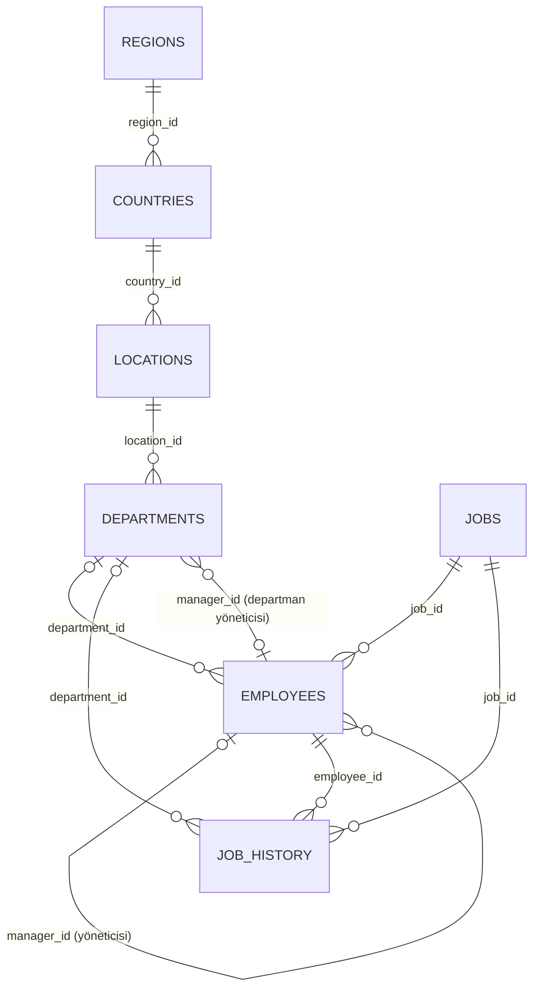
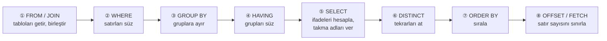
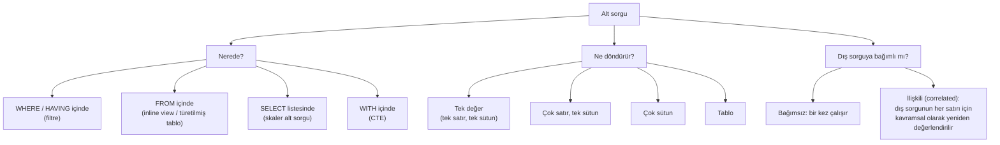
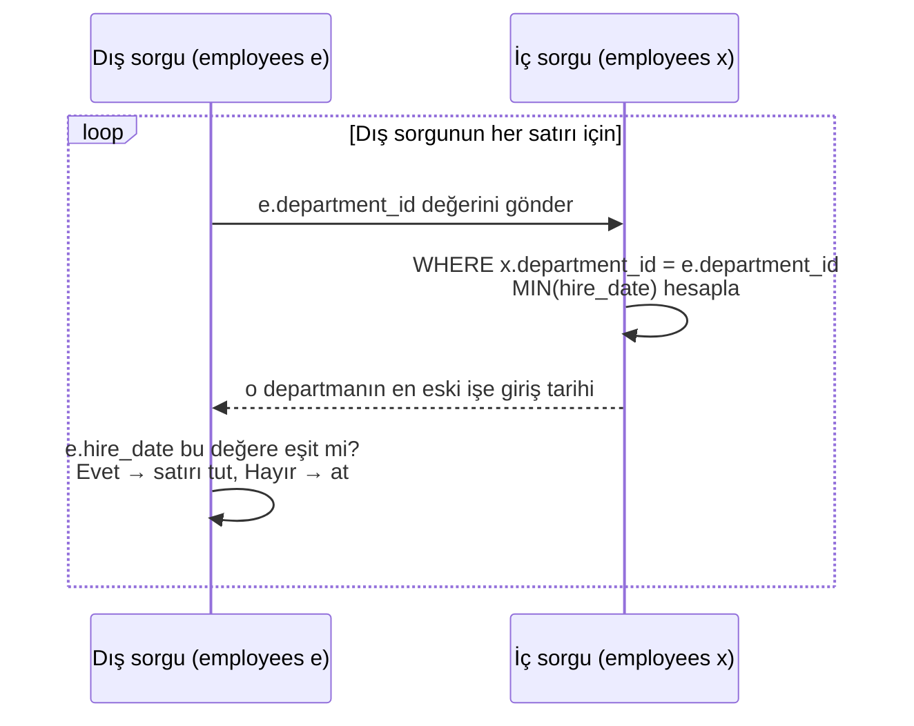
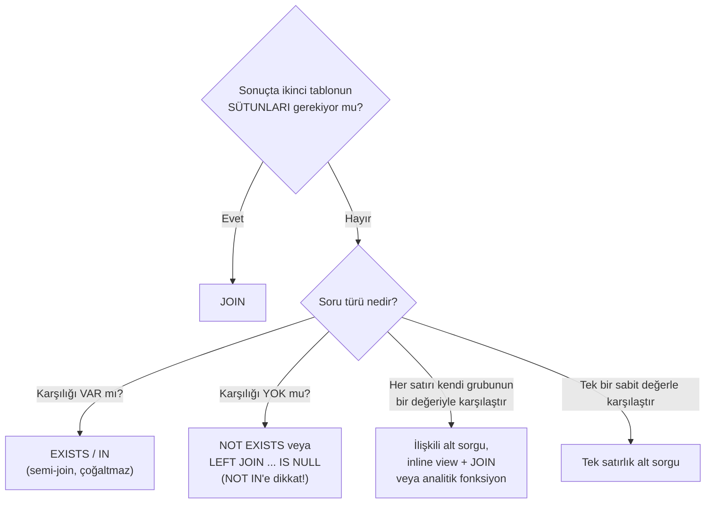
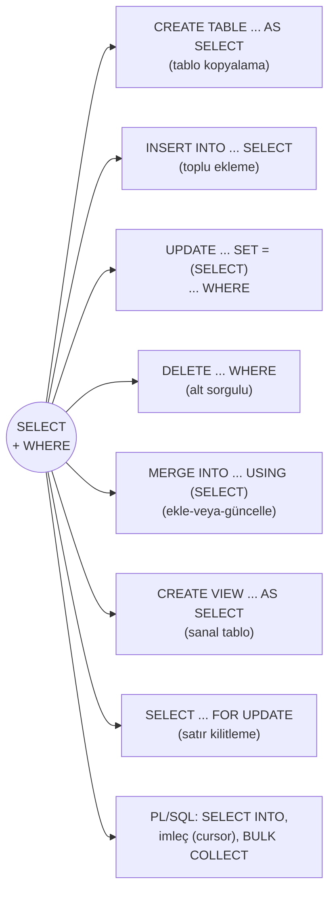
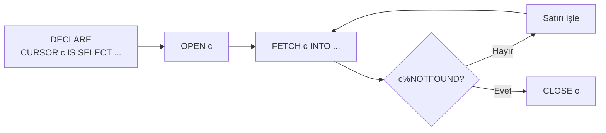

# SQL SELECT Sorgusu — A'dan Z'ye Kapsamlı Rehber

**Ders:** İleri Veritabanı Programlama · **Bölüm:** Yönetim Bilişim Sistemleri
**Ortam:** Oracle Database · HR örnek şeması · SQL ve PL/SQL

> **Bu dokümanı nasıl kullanmalısınız?**
> - Her bölümdeki sorguları **kendiniz yazarak** (kopyala-yapıştır yerine) SQL Developer veya SQL*Plus'ta çalıştırın.
> - HR şemasındaki sorguların sonuçlarını **kendi ortamınızda gözlemleyin**: satır sayısını not edin, beklediğinizle karşılaştırın. HR verisi Oracle sürümüne göre küçük farklar gösterebilir.
> - Dokümandaki "beklenen sonuç" tabloları yalnızca **Bölüm 0.3'te birlikte oluşturduğumuz küçük örnek tablolar** içindir; bu tablolar kasıtlı olarak küçüktür ki sonucu kâğıt üzerinde de hesaplayabilesiniz.
> - `-- yorum` satırları sorgunun parçası değildir; açıklama içindir.

---

## İçindekiler

0. Ön hazırlık: HR şeması ve örnek tablolar
1. SQL'e ve SELECT'e genel bakış
2. SELECT'in sözdizimi ve mantıksal işlem sırası
3. SELECT listesi (projeksiyon)
4. Tek satır fonksiyonları
5. WHERE cümleciği (seçim / filtreleme)
6. ORDER BY ve satır sınırlama
7. Toplama fonksiyonları, GROUP BY ve HAVING
8. JOIN türleri ve küme teorisi
9. Küme operatörleri: UNION, INTERSECT, MINUS
10. Alt sorgular (iç içe SELECT)
11. Analitik (pencere) fonksiyonlar ve PIVOT
12. SELECT ve WHERE'in diğer SQL komutlarında kullanımı
13. PL/SQL içinde SELECT
14. Sık karşılaşılan Oracle hataları
15. Performans ve iyi uygulamalar
16. Alıştırmalar (5 seviye)
17. Hızlı başvuru kartı
- Ek A: Türkçe–İngilizce terimler sözlüğü
- Ek B: Temizlik betiği

---

## 0. Ön hazırlık: HR şeması ve örnek tablolar

### 0.1 HR şemasının ilişki (ER) diyagramı



> Diyagramı okuma: `||--o{` "bire-çok" demektir. Örneğin bir departmanda **çok** çalışan olabilir, bir çalışan en fazla **bir** departmana bağlıdır. `|o` işareti ilişkinin **isteğe bağlı** olduğunu (yabancı anahtarın NULL olabileceğini) gösterir.

### 0.2 Tablolar ve sütunlar

| Tablo | Sütunlar (PK = birincil anahtar, FK = yabancı anahtar) |
|---|---|
| `REGIONS` | `region_id` (PK), `region_name` |
| `COUNTRIES` | `country_id` (PK), `country_name`, `region_id` (FK) |
| `LOCATIONS` | `location_id` (PK), `street_address`, `postal_code`, `city`, `state_province`, `country_id` (FK) |
| `DEPARTMENTS` | `department_id` (PK), `department_name`, `manager_id` (FK → EMPLOYEES), `location_id` (FK) |
| `JOBS` | `job_id` (PK), `job_title`, `min_salary`, `max_salary` |
| `EMPLOYEES` | `employee_id` (PK), `first_name`, `last_name`, `email`, `phone_number`, `hire_date`, `job_id` (FK), `salary`, `commission_pct`, `manager_id` (FK → EMPLOYEES), `department_id` (FK) |
| `JOB_HISTORY` | `employee_id` + `start_date` (birleşik PK), `end_date`, `job_id` (FK), `department_id` (FK) |

**Kendiniz doğrulayın:** Sütun adlarını ve veri tiplerini her zaman veritabanından kontrol edin:

```sql
DESC employees;
DESC departments;
```

> HR kullanıcısı dışında bir kullanıcıyla bağlandıysanız tablo adlarının önüne şema adını yazın: `hr.employees`.

### 0.3 Küçük örnek tablolar ("oyuncak veri")

JOIN ve küme işlemlerini **sonucunu önceden hesaplayabileceğiniz** küçük tablolarla öğrenmek çok daha kolaydır. Aşağıdaki betiği SQL Developer'da **betik olarak (F5)** çalıştırın:

```sql
CREATE TABLE bolum (
    bolum_id   NUMBER PRIMARY KEY,
    bolum_adi  VARCHAR2(30)
);

CREATE TABLE ogrenci (
    ogr_id     NUMBER PRIMARY KEY,
    ad         VARCHAR2(30),
    bolum_id   NUMBER REFERENCES bolum (bolum_id)
);

INSERT INTO bolum VALUES (10, 'YBS');
INSERT INTO bolum VALUES (20, 'İşletme');
INSERT INTO bolum VALUES (30, 'İktisat');

INSERT INTO ogrenci VALUES (1, 'Ali',   10);
INSERT INTO ogrenci VALUES (2, 'Ayşe',  20);
INSERT INTO ogrenci VALUES (3, 'Can',   10);
INSERT INTO ogrenci VALUES (4, 'Deniz', NULL);   -- henüz bölümü yok

CREATE TABLE kume_a (deger NUMBER);
CREATE TABLE kume_b (deger NUMBER);

INSERT INTO kume_a VALUES (1);
INSERT INTO kume_a VALUES (2);
INSERT INTO kume_a VALUES (3);
INSERT INTO kume_a VALUES (3);   -- bilerek tekrar eden değer

INSERT INTO kume_b VALUES (2);
INSERT INTO kume_b VALUES (3);
INSERT INTO kume_b VALUES (4);

COMMIT;
```

Oluşan veri:

```text
  ogrenci                             bolum
  ┌────────┬───────┬──────────┐       ┌──────────┬───────────┐
  │ ogr_id │ ad    │ bolum_id │       │ bolum_id │ bolum_adi │
  ├────────┼───────┼──────────┤       ├──────────┼───────────┤
  │ 1      │ Ali   │ 10       │       │ 10       │ YBS       │
  │ 2      │ Ayşe  │ 20       │       │ 20       │ İşletme   │
  │ 3      │ Can   │ 10       │       │ 30       │ İktisat   │  ← öğrencisi yok
  │ 4      │ Deniz │ (null)   │  ←    └──────────┴───────────┘
  └────────┴───────┴──────────┘  bölümü yok

  kume_a: {1, 2, 3, 3}            kume_b: {2, 3, 4}
```

---

## 1. SQL'e ve SELECT'e genel bakış

SQL (Structured Query Language) **bildirimsel (declarative)** bir dildir: *ne* istediğinizi söylersiniz, *nasıl* bulunacağına veritabanının **sorgu iyileştiricisi (optimizer)** karar verir.

| Alt dil | Açılım | Komutlar | Amaç |
|---|---|---|---|
| **DQL** | Data Query Language | `SELECT` | Veri sorgulama |
| **DML** | Data Manipulation Language | `INSERT`, `UPDATE`, `DELETE`, `MERGE` | Veriyi değiştirme |
| **DDL** | Data Definition Language | `CREATE`, `ALTER`, `DROP`, `TRUNCATE`, `RENAME` | Yapı tanımlama |
| **DCL** | Data Control Language | `GRANT`, `REVOKE` | Yetkilendirme |
| **TCL** | Transaction Control Language | `COMMIT`, `ROLLBACK`, `SAVEPOINT` | İşlem (transaction) yönetimi |

> Oracle belgelerinde `SELECT` çoğu zaman DML altında da sayılır. Önemli olan şudur: **SELECT veriyi değiştirmez**; ancak bu dokümanda göreceğiniz gibi diğer tüm komutların "beyni" olarak kullanılır.

**SELECT'in üç temel yeteneği** (ilişkisel cebirden gelir):

```text
 PROJEKSİYON (π)              SEÇİM (σ)                    BİRLEŞTİRME (⋈)
 Hangi SÜTUNLAR?              Hangi SATIRLAR?              Hangi TABLOLAR?
 ┌──┬──┬──┬──┐               ┌──┬──┬──┬──┐               ┌──┬──┐   ┌──┬──┐
 │  │██│  │██│               │  │  │  │  │               │██│██│ + │██│██│
 │  │██│  │██│               │██│██│██│██│ ← koşul       │██│██│   │██│██│
 │  │██│  │██│               │  │  │  │  │               └──┴──┘   └──┴──┘
 │  │██│  │██│               │██│██│██│██│ ← koşul        ortak sütun üzerinden
 └──┴──┴──┴──┘               └──┴──┴──┴──┘
 SELECT listesi              WHERE cümleciği              FROM ... JOIN ... ON
```

---

## 2. SELECT'in sözdizimi ve mantıksal işlem sırası

### 2.1 Tam iskelet

```sql
[WITH alt_sorgu_adi AS (...)]                  -- isteğe bağlı: ortak tablo ifadesi
SELECT [DISTINCT] sutun_veya_ifade [AS takma_ad], ...
FROM   tablo [takma_ad]
       [ [INNER | LEFT | RIGHT | FULL] JOIN diger_tablo ON kosul ]
[WHERE   satir_kosulu]
[GROUP BY gruplama_ifadeleri]
[HAVING  grup_kosulu]
[ORDER BY siralama_ifadeleri [ASC | DESC] [NULLS FIRST | NULLS LAST]]
[OFFSET n ROWS] [FETCH FIRST m ROWS ONLY];
```

Yalnızca `SELECT` ve `FROM` zorunludur (Oracle 23ai'de `FROM` bile isteğe bağlı hâle geldi; eski sürümlerde sabit değerler için `FROM dual` kullanılır).

### 2.2 Yazım sırası ≠ çalışma sırası

Sorguyu **yazdığımız sıra** ile veritabanının onu **mantıksal olarak işlediği sıra** farklıdır. Bu tek fikir, SELECT ile ilgili hataların yarısını açıklar.



**Bu sıranın doğrudan sonuçları:**

| Durum | Sonuç | Neden? |
|---|---|---|
| `WHERE` içinde SELECT'teki takma adı kullanmak | ❌ `ORA-00904: invalid identifier` | WHERE (②) çalışırken takma ad (⑤) henüz yok |
| `WHERE AVG(salary) > 5000` | ❌ `ORA-00934: group function is not allowed here` | Gruplar (③) WHERE'den sonra oluşur → `HAVING` kullanın |
| `ORDER BY` içinde takma ad kullanmak | ✅ Çalışır | ORDER BY (⑦) SELECT'ten (⑤) sonra gelir |
| `HAVING` içinde takma ad | ❌ 23ai öncesi sürümlerde çalışmaz | HAVING (④) SELECT'ten önce gelir |

```sql
-- HATALI: yillik takma adı WHERE aşamasında henüz tanımlı değil
SELECT last_name, salary * 12 AS yillik
FROM   employees
WHERE  yillik > 100000;

-- DOĞRU: ifadeyi WHERE'de tekrar yazın ...
SELECT last_name, salary * 12 AS yillik
FROM   employees
WHERE  salary * 12 > 100000
ORDER  BY yillik DESC;          -- ... ORDER BY'da ise takma ad serbest
```

---

## 3. SELECT listesi (projeksiyon)

### 3.1 Tüm sütunlar ve seçili sütunlar

```sql
SELECT * FROM departments;                          -- tüm sütunlar

SELECT employee_id, first_name, last_name, salary   -- yalnızca gerekenler
FROM   employees;
```

> **İyi uygulama:** Uygulama kodunda `SELECT *` kullanmayın. Tabloya sütun eklenince sorgu davranışı değişir, gereksiz veri taşınır. `*` yalnızca keşif amaçlı sorgularda kullanılır.

### 3.2 Takma adlar (alias)

```sql
SELECT last_name          AS soyad,          -- AS isteğe bağlıdır
       salary * 12        yillik_maas,
       hire_date          AS "İşe Giriş Tarihi"  -- çift tırnak: boşluk, Türkçe karakter, büyük/küçük harf korunur
FROM   employees;
```

- Tırnaksız takma adlar Oracle'da **büyük harfe** çevrilir (`soyad` → `SOYAD`).
- Çift tırnaklı takma adlar yazıldığı gibi kalır; boşluk ve özel karakter içerebilir.
- Tablolara da takma ad verilir: `FROM employees e` (tablo takma adında `AS` **kullanılmaz**).

### 3.3 Aritmetik ifadeler ve NULL'un etkisi

Öncelik: `*` ve `/` → `+` ve `-`. Parantez her zaman önce hesaplanır.

```sql
SELECT last_name,
       salary,
       commission_pct,
       salary * 12 + 100                              AS a,   -- (salary*12)+100
       salary * (12 + 100)                            AS b,
       salary * 12 * (1 + commission_pct)             AS yillik_hatali,
       salary * 12 * (1 + NVL(commission_pct, 0))     AS yillik_dogru
FROM   employees;
```

> ⚠️ **NULL ile yapılan her aritmetik işlemin sonucu NULL'dur.** Komisyonu olmayan çalışanlar için `yillik_hatali` sütununun boş çıkmasını gözlemleyin. NULL "sıfır" değil, **"bilinmeyen / değer yok"** demektir.

### 3.4 Metin birleştirme ve sabitler

```sql
SELECT first_name || ' ' || last_name                      AS ad_soyad,
       last_name || ' kişisinin görevi: ' || job_id         AS aciklama,
       last_name || q'['in e-posta kullanıcı adı: ]' || email AS eposta_bilgisi,
       'King''in tek tırnağı'                               AS kacis_ornegi
FROM   employees;
```

- `||` birleştirme operatörüdür; `CONCAT(a, b)` yalnızca iki argüman alır.
- Metin sabitleri **tek tırnak** içindedir. Metin içinde tek tırnak gerekiyorsa ya iki kez yazın (`''`) ya da **q-tırnak** operatörünü kullanın: `q'[...]'`.
- Oracle'da **boş metin (`''`) NULL kabul edilir.** `WHERE ad = ''` hiçbir zaman satır döndürmez.

### 3.5 DISTINCT — tekrar eden satırları atma

```sql
SELECT DISTINCT department_id FROM employees;            -- her departman bir kez

SELECT DISTINCT department_id, job_id FROM employees;    -- (departman, iş) ÇİFTİ benzersiz
```

> `DISTINCT` tek bir sütuna değil, **SELECT listesindeki tüm sütunların birleşimine** uygulanır.

### 3.6 DUAL tablosu

`DUAL`, tek satır ve tek sütunlu özel bir Oracle tablosudur; bir tabloya bağlı olmayan ifadeleri hesaplamak için kullanılır:

```sql
SELECT SYSDATE, 7 * 6, UPPER('oracle') FROM dual;
```

### 3.7 NULL ile çalışma fonksiyonları

| Fonksiyon | Anlamı | Örnek |
|---|---|---|
| `NVL(a, b)` | `a` NULL ise `b`, değilse `a` | `NVL(commission_pct, 0)` |
| `NVL2(a, b, c)` | `a` NULL **değilse** `b`, NULL ise `c` | `NVL2(commission_pct, 'Primli', 'Primsiz')` |
| `COALESCE(a, b, c, ...)` | Listedeki **ilk NULL olmayan** değer | `COALESCE(commission_pct, 0)` |
| `NULLIF(a, b)` | `a = b` ise NULL, değilse `a` | `NULLIF(LENGTH(first_name), LENGTH(last_name))` |

```sql
SELECT last_name,
       commission_pct,
       NVL(commission_pct, 0)                       AS prim_orani,
       NVL2(commission_pct, 'Primli', 'Primsiz')    AS prim_durumu,
       NULLIF(LENGTH(first_name), LENGTH(last_name)) AS uzunluk_farkli_ise
FROM   employees;
```

### 3.8 Koşullu ifadeler: CASE ve DECODE

**Aranan (searched) CASE** — her `WHEN` bağımsız bir koşuldur, ilk doğru olan kazanır:

```sql
SELECT last_name, salary,
       CASE
           WHEN salary <  5000 THEN 'Düşük'
           WHEN salary < 10000 THEN 'Orta'
           ELSE 'Yüksek'
       END AS maas_seviyesi
FROM   employees;
```

**Basit (simple) CASE** ve onun Oracle'a özgü kısa hâli **DECODE**:

```sql
SELECT last_name, job_id, salary,
       CASE job_id
           WHEN 'IT_PROG'  THEN salary * 1.10
           WHEN 'ST_CLERK' THEN salary * 1.15
           ELSE salary
       END AS yeni_maas_case,
       DECODE(job_id, 'IT_PROG',  salary * 1.10,
                      'ST_CLERK', salary * 1.15,
                                  salary)       AS yeni_maas_decode
FROM   employees;
```

> `CASE` ANSI standardıdır ve her yerde (SQL ve PL/SQL) çalışır; `DECODE` yalnızca Oracle SQL'inde vardır. Yeni kodda `CASE` tercih edin.

---

## 4. Tek satır fonksiyonları

Tek satır fonksiyonları **her satır için bir sonuç** üretir (toplama fonksiyonlarının tersine). SELECT, WHERE, ORDER BY ve GROUP BY içinde kullanılabilirler.

```text
  Tek satır fonksiyonu                 Toplama (grup) fonksiyonu
  satır 1 ──► f() ──► sonuç 1          satır 1 ─┐
  satır 2 ──► f() ──► sonuç 2          satır 2 ─┼──► AVG() ──► tek sonuç
  satır 3 ──► f() ──► sonuç 3          satır 3 ─┘
```

Aşağıdaki "beklenen değer" sütunu, fonksiyonun tanımından hesaplanmıştır; `SELECT ... FROM dual` ile kendiniz doğrulayın.

| Tür | Fonksiyon | Örnek | Beklenen değer |
|---|---|---|---|
| Karakter | `UPPER`, `LOWER` | `UPPER('sql')` | `'SQL'` |
| | `INITCAP` | `INITCAP('veri tabanı')` | `'Veri Tabanı'` |
| | `SUBSTR(m, başlangıç, uzunluk)` | `SUBSTR('VERITABANI', 1, 4)` | `'VERI'` |
| | `INSTR(m, aranan)` | `INSTR('VERITABANI', 'TABAN')` | `5` |
| | `LENGTH` | `LENGTH('ORACLE')` | `6` |
| | `TRIM`, `LTRIM`, `RTRIM` | `TRIM('  ab  ')` | `'ab'` |
| | `LPAD`, `RPAD` | `LPAD('42', 5, '0')` | `'00042'` |
| | `REPLACE` | `REPLACE('A-B-C', '-', '/')` | `'A/B/C'` |
| Sayısal | `ROUND(n, b)` | `ROUND(45.926, 2)` | `45.93` |
| | `ROUND` (negatif basamak) | `ROUND(45.926, -1)` | `50` |
| | `TRUNC(n, b)` | `TRUNC(45.926, 2)` | `45.92` |
| | `MOD` | `MOD(1600, 300)` | `100` |
| | `CEIL`, `FLOOR` | `CEIL(4.1)`, `FLOOR(4.9)` | `5`, `4` |
| Tarih | `SYSDATE` | `SYSDATE` | Sunucunun anlık tarih-saati |
| | `ADD_MONTHS` | `ADD_MONTHS(DATE '2026-01-31', 1)` | `2026-02-28` |
| | `MONTHS_BETWEEN` | `MONTHS_BETWEEN(DATE '2026-03-01', DATE '2026-01-01')` | `2` |
| | `LAST_DAY` | `LAST_DAY(DATE '2026-02-10')` | `2026-02-28` |
| | `EXTRACT` | `EXTRACT(YEAR FROM DATE '2026-11-21')` | `2026` |
| Dönüşüm | `TO_CHAR(tarih, biçim)` | `TO_CHAR(DATE '2026-11-21', 'DD.MM.YYYY')` | `'21.11.2026'` |
| | `TO_CHAR(sayı, biçim)` | `TO_CHAR(12500, 'FM99,999')` | `'12,500'` |
| | `TO_NUMBER` | `TO_NUMBER('1234')` | `1234` |
| | `TO_DATE` | `TO_DATE('21.11.2026', 'DD.MM.YYYY')` | `2026-11-21` |
| | `CAST` | `CAST('15' AS NUMBER)` | `15` |

**Tarih aritmetiği:** Tarihten tarih çıkarmak **gün sayısı** verir; tarihe sayı eklemek gün ekler.

```sql
SELECT last_name,
       hire_date,
       TRUNC(SYSDATE - hire_date)                       AS calistigi_gun,
       TRUNC(MONTHS_BETWEEN(SYSDATE, hire_date) / 12)   AS kidem_yili,
       hire_date + 90                                   AS deneme_suresi_bitis,
       TO_CHAR(hire_date, 'DD Month YYYY, Day')         AS uzun_bicim
FROM   employees
ORDER  BY kidem_yili DESC;
```

> **Fonksiyonlar iç içe kullanılabilir** ve içten dışa doğru değerlendirilir:
> `UPPER(SUBSTR(last_name, 1, 3))` → önce ilk 3 harf alınır, sonra büyütülür.

---

## 5. WHERE cümleciği (seçim / filtreleme)

WHERE, FROM'dan gelen **her satır** için bir koşulu değerlendirir; yalnızca koşulu **TRUE** olan satırlar geçer (FALSE ve **UNKNOWN** olanlar elenir).

```text
  FROM'dan gelen satırlar        WHERE salary > 10000          Sonuç
  ┌──────────────┐               ┌──────────────────┐          ┌──────────────┐
  │ King   24000 │ ────────────► │ TRUE   → geçer   │ ───────► │ King   24000 │
  │ Lorentz 4200 │ ────────────► │ FALSE  → elenir  │          │ ...          │
  │ X       NULL │ ────────────► │ UNKNOWN→ elenir  │          └──────────────┘
  └──────────────┘               └──────────────────┘
```

### 5.1 Karşılaştırma operatörleri

| Operatör | Anlam | Operatör | Anlam |
|---|---|---|---|
| `=` | eşit | `<>`, `!=`, `^=` | eşit değil |
| `<`, `>` | küçük, büyük | `<=`, `>=` | küçük-eşit, büyük-eşit |
| `BETWEEN a AND b` | a ile b arasında (**uçlar dahil**) | `IN (liste)` | listedeki değerlerden biri |
| `LIKE 'kalıp'` | metin kalıbı | `IS NULL` / `IS NOT NULL` | NULL kontrolü |

```sql
SELECT last_name, salary
FROM   employees
WHERE  salary BETWEEN 5000 AND 8000;          -- 5000 ve 8000 dahil

SELECT last_name, department_id
FROM   employees
WHERE  department_id IN (10, 20, 90);         -- = 10 OR = 20 OR = 90

SELECT last_name, hire_date
FROM   employees
WHERE  hire_date >= DATE '2005-01-01'         -- ANSI tarih sabiti
AND    hire_date <  DATE '2006-01-01';        -- 2005 yılında işe girenler
```

> Metin karşılaştırmaları **büyük/küçük harfe duyarlıdır**: `WHERE last_name = 'king'` satır döndürmez, `'King'` döndürür. Gerekirse `UPPER(last_name) = 'KING'` yazın.

### 5.2 LIKE ve joker karakterler

| Joker | Anlamı |
|---|---|
| `%` | sıfır veya daha fazla **herhangi** karakter |
| `_` | **tam olarak bir** herhangi karakter |

```sql
WHERE last_name LIKE 'K%'        -- K ile başlayan
WHERE last_name LIKE '%a'        -- a ile biten
WHERE last_name LIKE '_a%'       -- ikinci harfi a olan
WHERE last_name NOT LIKE '%e%'   -- içinde e geçmeyen
WHERE job_id LIKE 'SA\_%' ESCAPE '\'   -- gerçek alt çizgi: SA_ ile başlayan
```

> Neden `ESCAPE`? `'SA_%'` kalıbında `_` joker olduğu için "SA + herhangi bir karakter + ..." anlamına gelir. Alt çizgiyi **harfiyen** aramak için kaçış karakteri tanımlarız.

**Düzenli ifade (regex)** gerekiyorsa:

```sql
SELECT first_name, last_name
FROM   employees
WHERE  REGEXP_LIKE(first_name, '^Ste(v|ph)en$');   -- Steven veya Stephen
```

### 5.3 NULL kontrolü

```sql
SELECT last_name FROM employees WHERE commission_pct IS NULL;      -- ✅
SELECT last_name FROM employees WHERE commission_pct = NULL;       -- ❌ hiç satır dönmez
```

`= NULL` karşılaştırmasının sonucu her zaman **UNKNOWN**'dır; UNKNOWN da WHERE'den geçemez.

### 5.4 Mantıksal operatörler ve öncelik

Öncelik sırası: **`NOT` → `AND` → `OR`**. Parantez her şeyi geçersiz kılar.

```sql
-- (1) AND önce bağlar:  SA_REP olanların HEPSİ  +  maaşı 15000'den büyük AD_PRES
SELECT last_name, job_id, salary
FROM   employees
WHERE  job_id = 'SA_REP'
OR     job_id = 'AD_PRES' AND salary > 15000;

-- (2) Parantezle:  (SA_REP veya AD_PRES)  VE  maaşı 15000'den büyük
SELECT last_name, job_id, salary
FROM   employees
WHERE  (job_id = 'SA_REP' OR job_id = 'AD_PRES')
AND    salary > 15000;
```

> İki sorgunun satır sayısını karşılaştırın ve farkı kendi cümlelerinizle açıklayın.

### 5.5 Üç değerli mantık (TRUE / FALSE / UNKNOWN)

NULL'un varlığı nedeniyle SQL'de mantık iki değil **üç değerlidir**:

> **NULL ile UNKNOWN aynı şey mi?** Hayır. **NULL** bir hücredeki *veri*dir (değerin yokluğu); **UNKNOWN** ise bir *koşulun sonucu*dur. NULL bir karşılaştırmaya girince sonuç UNKNOWN olur: `commission_pct = 0.2` → komisyonu NULL olan satırda UNKNOWN. `IS NULL` / `IS NOT NULL` ise hiçbir zaman UNKNOWN üretmez, her zaman TRUE ya da FALSE döner. Oracle'da `UNKNOWN` diye yazılabilen bir anahtar sözcük yoktur; UNKNOWN yalnızca koşul değerlendirilirken oluşur. (SQL standardında ve Oracle 23ai'nin `BOOLEAN` türünde, NULL olan bir mantıksal değer UNKNOWN anlamına gelir.)

| AND | TRUE | FALSE | UNKNOWN |
|---|---|---|---|
| **TRUE** | TRUE | FALSE | UNKNOWN |
| **FALSE** | FALSE | FALSE | FALSE |
| **UNKNOWN** | UNKNOWN | FALSE | UNKNOWN |

| OR | TRUE | FALSE | UNKNOWN |
|---|---|---|---|
| **TRUE** | TRUE | TRUE | TRUE |
| **FALSE** | TRUE | FALSE | UNKNOWN |
| **UNKNOWN** | TRUE | UNKNOWN | UNKNOWN |

`NOT UNKNOWN` = UNKNOWN. Bu tablo, Bölüm 10.4'teki meşhur **NOT IN tuzağının** anahtarıdır.

### 5.6 ANY ve ALL (sabit listeyle)

```sql
WHERE salary > ANY (5000, 10000)   -- en az birinden büyük  ≡  salary > 5000
WHERE salary > ALL (5000, 10000)   -- hepsinden büyük        ≡  salary > 10000
```

Asıl gücü alt sorgularla ortaya çıkar (Bölüm 10.3).

### 5.7 Yerine koyma (substitution) değişkenleri

SQL Developer ve SQL*Plus'ta sorguyu her çalıştırmada farklı değerle denemek için:

```sql
SELECT last_name, salary
FROM   employees
WHERE  department_id = &departman_no;      -- çalıştırınca değer sorulur
```

---

## 6. ORDER BY ve satır sınırlama

### 6.1 Sıralama seçenekleri

```sql
SELECT last_name, department_id, salary, salary * 12 AS yillik
FROM   employees
ORDER  BY department_id ASC,      -- önce departmana göre artan
          salary DESC;            -- aynı departman içinde maaşa göre azalan
```

| Biçim | Örnek | Not |
|---|---|---|
| Sütun adı | `ORDER BY last_name` | Varsayılan `ASC` |
| Takma ad | `ORDER BY yillik DESC` | SELECT'ten sonra çalıştığı için geçerli |
| Konum numarası | `ORDER BY 3 DESC` | SELECT listesindeki 3. sütun; okunabilirliği düşürür |
| İfade | `ORDER BY LENGTH(last_name)` | Her ifade kullanılabilir |
| SELECT'te olmayan sütun | `ORDER BY hire_date` | Geçerli (`DISTINCT` yoksa) |
| NULL'ların yeri | `ORDER BY commission_pct DESC NULLS LAST` | Oracle varsayılanı: `ASC`'de NULL'lar **sonda**, `DESC`'te **başta** |
| Özel sıra | `ORDER BY CASE WHEN job_id = 'AD_PRES' THEN 0 ELSE 1 END, last_name` | Önce genel müdür, sonra alfabetik |

> **ORDER BY yoksa sıra garanti edilmez.** Sorgu bugün sıralı görünse bile yarın farklı dönebilir.

### 6.2 İlk N satır ve sayfalama (Oracle 12c+)

```sql
-- En yüksek maaşlı 5 çalışan
SELECT last_name, salary
FROM   employees
ORDER  BY salary DESC
FETCH  FIRST 5 ROWS ONLY;

-- 5. sıradaki ile AYNI maaşı alanlar da gelsin (eşitlikler dahil)
SELECT last_name, salary
FROM   employees
ORDER  BY salary DESC
FETCH  FIRST 5 ROWS WITH TIES;

-- En yüksek %10
SELECT last_name, salary
FROM   employees
ORDER  BY salary DESC
FETCH  FIRST 10 PERCENT ROWS ONLY;

-- Sayfalama: sayfa boyutu 10, 3. sayfa  →  OFFSET (3-1)*10
SELECT employee_id, last_name
FROM   employees
ORDER  BY employee_id
OFFSET 20 ROWS FETCH NEXT 10 ROWS ONLY;
```

### 6.3 ROWNUM tuzağı (eski yöntem)

`ROWNUM`, satıra **WHERE aşamasında**, yani **ORDER BY'dan önce** verilen geçici bir numaradır.

```sql
-- ❌ YANLIŞ: rastgele 5 satırı alır, SONRA onları sıralar
SELECT last_name, salary
FROM   employees
WHERE  ROWNUM <= 5
ORDER  BY salary DESC;

-- ✅ DOĞRU: önce iç sorguda sırala, sonra dışarıda kes
SELECT *
FROM   (SELECT last_name, salary FROM employees ORDER BY salary DESC)
WHERE  ROWNUM <= 5;
```

> `WHERE ROWNUM > 1` **hiçbir zaman** satır döndürmez: ilk satır 1 numarayı alır, koşulu sağlamaz, atılır; bir sonraki satır yine 1 numarayı alır...

---

## 7. Toplama fonksiyonları, GROUP BY ve HAVING

### 7.1 Toplama (aggregate) fonksiyonları

| Fonksiyon | Açıklama | NULL davranışı |
|---|---|---|
| `COUNT(*)` | Satır sayısı | NULL'lar **dahil** |
| `COUNT(sütun)` | Sütunu NULL olmayan satır sayısı | NULL'ları **yok sayar** |
| `COUNT(DISTINCT sütun)` | Farklı (NULL olmayan) değer sayısı | NULL'ları yok sayar |
| `SUM`, `AVG` | Toplam, ortalama (sayısal) | NULL'ları yok sayar |
| `MIN`, `MAX` | En küçük, en büyük (sayı, metin, tarih) | NULL'ları yok sayar |
| `STDDEV`, `VARIANCE` | Standart sapma, varyans | NULL'ları yok sayar |
| `LISTAGG` | Değerleri tek metinde birleştirir | NULL'ları yok sayar |

```sql
SELECT COUNT(*)                        AS toplam_calisan,
       COUNT(commission_pct)           AS primli_calisan,
       COUNT(DISTINCT department_id)   AS farkli_departman,
       SUM(salary)                     AS toplam_maas,
       ROUND(AVG(salary), 2)           AS ortalama_maas,
       MIN(hire_date)                  AS en_eski_ise_giris,
       MAX(last_name)                  AS alfabetik_son
FROM   employees;
```

> **Düşünme sorusu:** `AVG(commission_pct)` ile `AVG(NVL(commission_pct, 0))` neden farklı sonuç verir? Hangisi "şirketteki ortalama prim oranı" sorusunun doğru cevabıdır? (İpucu: Paydada kaç satır var?)

### 7.2 GROUP BY: satırları kovalara ayırmak

GROUP BY, satırları belirtilen sütun(lar)ın değerine göre **gruplara** ayırır ve **her grup için tek bir satır** üretir. Örnek tablomuzla:

```sql
SELECT bolum_id, COUNT(*) AS ogrenci_sayisi
FROM   ogrenci
GROUP  BY bolum_id;
```

```text
 ogrenci satırları           ③ GROUP BY bolum_id               ⑤ SELECT (her kova → 1 satır)
 ─────────────────           ───────────────────               ─────────────────────────────
 Ali   (10)   ──┐
 Can   (10)   ──┴──────────► [ 10 ]   Ali, Can        ──────►  bolum_id = 10    sayi = 2
 Ayşe  (20)   ─────────────► [ 20 ]   Ayşe            ──────►  bolum_id = 20    sayi = 1
 Deniz (NULL) ─────────────► [NULL]   Deniz           ──────►  bolum_id = NULL  sayi = 1
```

**Beklenen sonuç (3 satır, sıra garanti değil):**

| bolum_id | ogrenci_sayisi |
|---|---|
| 10 | 2 |
| 20 | 1 |
| (null) | 1 |

> Dikkat: **NULL değerler kendi aralarında tek bir grup oluşturur.** WHERE'de `NULL = NULL` UNKNOWN iken GROUP BY'da NULL'lar bir arada toplanır.

HR üzerinde:

```sql
SELECT department_id,
       COUNT(*)              AS calisan_sayisi,
       ROUND(AVG(salary))    AS ortalama_maas,
       MAX(salary)           AS en_yuksek_maas
FROM   employees
GROUP  BY department_id
ORDER  BY department_id;
```

### 7.3 GROUP BY'ın altın kuralı

> SELECT listesinde **toplama fonksiyonu içinde olmayan her sütun**, GROUP BY'da da yer almalıdır.

```sql
-- ❌ ORA-00979: not a GROUP BY expression
--    Bir departmanda birden fazla last_name var; hangisini göstersin?
SELECT department_id, last_name, COUNT(*)
FROM   employees
GROUP  BY department_id;

-- ❌ ORA-00937: not a single-group group function
--    GROUP BY yok ama toplama ile normal sütun karışmış
SELECT department_id, COUNT(*)
FROM   employees;

-- ✅ Çok sütunlu gruplama: her (departman, iş) çifti ayrı grup
SELECT department_id, job_id, COUNT(*) AS kisi, SUM(salary) AS toplam
FROM   employees
GROUP  BY department_id, job_id
ORDER  BY department_id, job_id;
```

GROUP BY'da olup SELECT'te olmayan sütun **serbesttir** (ama sonucu yorumlamak zorlaşabilir).

### 7.4 HAVING: grupları süzmek

```text
  WHERE                          HAVING
  ─────                          ──────
  GRUPLAMADAN ÖNCE çalışır       GRUPLAMADAN SONRA çalışır
  SATIRLARI süzer                GRUPLARI süzer
  Toplama fonksiyonu YASAK       Toplama fonksiyonu kullanılır
```

```sql
SELECT   department_id,
         COUNT(*)            AS kisi,
         ROUND(AVG(salary))  AS ortalama_maas
FROM     employees
WHERE    job_id NOT LIKE '%CLERK'        -- ② memurları (CLERK) baştan çıkar
GROUP BY department_id                   -- ③ kalanları departmana göre grupla
HAVING   AVG(salary) > 8000              -- ④ ortalaması 8000'i aşan grupları tut
AND      COUNT(*) >= 2                   --    ve en az 2 kişilik olanları
ORDER BY ortalama_maas DESC;             -- ⑦
```

> **İyi uygulama:** Toplama gerektirmeyen koşulları HAVING'e değil **WHERE'e** yazın. WHERE satırları erkenden azaltır; gruplanacak veri küçülür.

### 7.5 İç içe toplama

Oracle, GROUP BY ile birlikte **iki seviyeye kadar** iç içe toplamaya izin verir:

```sql
-- Departman ortalamalarının en büyüğü
SELECT MAX(AVG(salary)) AS en_yuksek_departman_ortalamasi
FROM   employees
GROUP  BY department_id;
```

> Bu sorgunun SELECT listesine `department_id` ekleyemezsiniz; neden? (Sonuç tek satırdır; hangi departman olduğunu bulmak için Bölüm 10'daki alt sorgulara ya da Bölüm 11'deki analitik fonksiyonlara ihtiyacınız var.)

### 7.6 LISTAGG: grup içindeki değerleri birleştirmek

```sql
SELECT department_id,
       LISTAGG(last_name, ', ') WITHIN GROUP (ORDER BY last_name) AS calisanlar
FROM   employees
GROUP  BY department_id;
```

> Sonuç 4000 baytı aşarsa hata alırsınız; Oracle 12.2+'da `LISTAGG(... ON OVERFLOW TRUNCATE)` kullanılabilir.

### 7.7 ROLLUP, CUBE ve GROUPING SETS: ara toplamlar

```text
  GROUP BY ROLLUP (a, b)        GROUP BY CUBE (a, b)          GROUP BY GROUPING SETS ((a), (b), ())
  üretilen gruplamalar:         üretilen gruplamalar:         yalnızca istenenler:
    (a, b)  ← ayrıntı             (a, b)                         (a)
    (a)     ← a ara toplamı       (a)                            (b)
    ()      ← genel toplam        (b)                            ()
                                  ()
  n sütun → n+1 seviye          n sütun → 2ⁿ kombinasyon
```

```sql
SELECT   CASE WHEN GROUPING(department_id) = 1 THEN 'GENEL TOPLAM'
              ELSE TO_CHAR(department_id) END             AS departman,
         CASE WHEN GROUPING(job_id) = 1 THEN '(ara toplam)'
              ELSE job_id END                             AS is_kodu,
         SUM(salary)                                      AS toplam_maas
FROM     employees
WHERE    department_id IN (20, 50, 80)
GROUP BY ROLLUP (department_id, job_id)
ORDER BY department_id, job_id;
```

`GROUPING(sütun)`, o satırda sütunun **toplamdan dolayı** NULL olduğunu (1) mı yoksa verinin gerçekten NULL olduğunu (0) mı ayırt eder.

---

## 8. JOIN türleri ve küme teorisi

### 8.1 Teorik temel: tablo bir kümedir (neredeyse)

İlişkisel modelde bir tablo, **satırlardan oluşan bir kümedir**. (Kesin konuşmak gerekirse SQL tabloları tekrar eden satırlara izin verdiği için **çoklu küme — multiset / bag** olarak davranır; `DISTINCT` ve `UNION` bu çoklu kümeyi gerçek kümeye çevirir.)

SQL işlemlerinin ilişkisel cebirdeki karşılıkları:

| İlişkisel cebir | Sembol | SQL karşılığı |
|---|---|---|
| Seçim (selection) | σ<sub>koşul</sub>(R) | `WHERE koşul` |
| Projeksiyon (projection) | π<sub>sütunlar</sub>(R) | `SELECT sütunlar` |
| Kartezyen çarpım | R × S | `CROSS JOIN` |
| Birleştirme (join) | R ⋈<sub>koşul</sub> S | `JOIN ... ON koşul` |
| Birleşim | R ∪ S | `UNION` |
| Kesişim | R ∩ S | `INTERSECT` |
| Fark | R − S | `MINUS` (21c+ `EXCEPT`) |
| Yeniden adlandırma | ρ | Takma ad (`AS`) |
| Gruplama | γ | `GROUP BY` |

**En önemli eşitlik:**

> **R ⋈<sub>koşul</sub> S = σ<sub>koşul</sub>(R × S)**
> Bir JOIN, kavramsal olarak "önce Kartezyen çarpımı al, sonra koşulu sağlayan satırları seç" demektir. (Veritabanı bunu gerçekte çok daha akıllıca yapar; ama **mantığı** budur.)

### 8.2 Kartezyen çarpım — CROSS JOIN

A'nın **her** satırı B'nin **her** satırıyla eşleştirilir: |A × B| = |A| · |B|.

```sql
SELECT o.ad, b.bolum_adi
FROM   ogrenci o
CROSS  JOIN bolum b;            -- 4 × 3 = 12 satır
```

```text
                     bolum →   10 YBS        20 İşletme     30 İktisat
  ogrenci ↓                  ┌─────────────┬──────────────┬──────────────┐
  1 Ali    (bolum_id=10)     │  eşleşir    │              │              │
  2 Ayşe   (bolum_id=20)     │             │  eşleşir     │              │
  3 Can    (bolum_id=10)     │  eşleşir    │              │              │
  4 Deniz  (bolum_id=NULL)   │             │              │              │
                             └─────────────┴──────────────┴──────────────┘
  CROSS JOIN  = 12 hücrenin TAMAMI
  INNER JOIN  = σ(o.bolum_id = b.bolum_id) → yalnızca "eşleşir" yazan 3 hücre
```

> **Kazara Kartezyen çarpım:** Eski sözdiziminde (`FROM a, b`) JOIN koşulunu unutursanız sorgu hata vermez; HR'da `employees × departments` binlerce satır üretir. **N tablo birleştiriyorsanız en az N−1 JOIN koşulu** gerekir.

### 8.3 Venn diyagramlarıyla JOIN türleri

```text
INNER JOIN                  LEFT [OUTER] JOIN
╭───────────╮               ╭───────────╮
│      ╭────┼────────╮      │▓▓▓▓▓▓╭────┼────────╮
│      │▓▓▓▓│        │      │▓▓▓▓▓▓│▓▓▓▓│        │
│      │▓▓▓▓│        │      │▓▓▓▓▓▓│▓▓▓▓│        │
╰──────┼────╯        │      ╰──────┼────╯        │
       ╰─────────────╯             ╰─────────────╯
   A     A∩B     B             A     A∩B     B
yalnız eşleşenler           A'nın tamamı

RIGHT [OUTER] JOIN          FULL OUTER JOIN
╭───────────╮               ╭───────────╮
│      ╭────┼────────╮      │▓▓▓▓▓▓╭────┼────────╮
│      │▓▓▓▓│▓▓▓▓▓▓▓▓│      │▓▓▓▓▓▓│▓▓▓▓│▓▓▓▓▓▓▓▓│
│      │▓▓▓▓│▓▓▓▓▓▓▓▓│      │▓▓▓▓▓▓│▓▓▓▓│▓▓▓▓▓▓▓▓│
╰──────┼────╯▓▓▓▓▓▓▓▓│      ╰──────┼────╯▓▓▓▓▓▓▓▓│
       ╰─────────────╯             ╰─────────────╯
   A     A∩B     B             A     A∩B     B
B'nin tamamı                her ikisinin tamamı

LEFT ANTI-JOIN              RIGHT ANTI-JOIN
╭───────────╮               ╭───────────╮
│▓▓▓▓▓▓╭────┼────────╮      │      ╭────┼────────╮
│▓▓▓▓▓▓│    │        │      │      │    │▓▓▓▓▓▓▓▓│
│▓▓▓▓▓▓│    │        │      │      │    │▓▓▓▓▓▓▓▓│
╰──────┼────╯        │      ╰──────┼────╯▓▓▓▓▓▓▓▓│
       ╰─────────────╯             ╰─────────────╯
   A     A∩B     B             A     A∩B     B
LEFT JOIN+B.pk IS NULL      RIGHT JOIN+A.pk IS NULL

FULL ANTI-JOIN
╭───────────╮
│▓▓▓▓▓▓╭────┼────────╮
│▓▓▓▓▓▓│    │▓▓▓▓▓▓▓▓│
│▓▓▓▓▓▓│    │▓▓▓▓▓▓▓▓│
╰──────┼────╯▓▓▓▓▓▓▓▓│
       ╰─────────────╯
   A     A∩B     B
FULL JOIN+biri NULL
```

> ⚠️ **Venn diyagramı bir metafordur.** JOIN aslında iki kümenin "kesişimi" değil, satırların bir koşula göre **eşleştirilmesidir**; bir satır birden fazla satırla eşleşip **çoğalabilir** (Bölüm 8.12). Venn diyagramı, "hangi satırlar sonuçta kalır / NULL ile tamamlanır" sorusunu hatırlamak için kullanışlıdır.

### 8.4 INNER JOIN — yalnızca eşleşenler

```sql
SELECT o.ad, b.bolum_adi
FROM   ogrenci o
INNER  JOIN bolum b ON o.bolum_id = b.bolum_id;   -- INNER kelimesi isteğe bağlı
```

**Beklenen sonuç (3 satır):**

| ad | bolum_adi |
|---|---|
| Ali | YBS |
| Ayşe | İşletme |
| Can | YBS |

Deniz (bölümü NULL) ve İktisat (öğrencisi yok) sonuçta **yoktur**.

**HR üzerinde — üç yazım biçimi:**

```sql
-- 1) ON: en esnek ve en açık biçim (önerilen)
SELECT e.employee_id, e.last_name, d.department_name
FROM   employees   e
JOIN   departments d ON e.department_id = d.department_id;

-- 2) USING: iki tabloda sütun adı aynıysa kısa yazım
SELECT employee_id, last_name, department_id, department_name
FROM   employees
JOIN   departments USING (department_id);
--     ⚠️ USING'deki sütun takma adla yazılamaz: e.department_id → ORA-25154

-- 3) NATURAL JOIN: AYNI ADLI TÜM sütunlar üzerinden otomatik eşleştirir
SELECT last_name, department_name
FROM   employees
NATURAL JOIN departments;
```

> 🪤 **NATURAL JOIN tuzağı (HR'da gerçek bir örnek):** `EMPLOYEES` ve `DEPARTMENTS` tablolarında **iki** ortak sütun vardır: `department_id` **ve** `manager_id`. NATURAL JOIN ikisini birden eşitler; yani yalnızca "yöneticisi, departmanın yöneticisiyle aynı kişi olan" çalışanları getirir. Sorgu 1 ile sorgu 3'ün satır sayısını karşılaştırın. **Ders:** NATURAL JOIN'i üretim kodunda kullanmayın.

**ON içinde eşitliğin yönü önemli mi?**

```sql
ON e.department_id = d.department_id
ON d.department_id = e.department_id   -- birebir aynı sonuç, aynı yürütme planı
```

Önemli değil. `=` simetriktir ve `ON` bir atama değil, bir **eşleştirme kuralıdır**: Oracle her `(e, d)` satır çifti için koşulun TRUE olup olmadığına bakar. Hangi tablonun önce okunacağına iyileştirici (optimizer) karar verir; bu karar koşulun yazım sırasından etkilenmez. Yaygın alışkanlık, koşulu `FROM`/`JOIN` sırasına uydurmaktır (önce soldaki tablo, sonra sağdaki). Bu yalnızca okunabilirlik içindir. Önemli olan, bir projede tutarlı olmaktır.

Sıranın **gerçekten** önemli olduğu durumlar şunlardır:

| Durum | Sıra önemli mi? | Neden |
|---|---|---|
| `ON a.x = b.x` ↔ `ON b.x = a.x` | Hayır | `=` simetriktir |
| `ON a.x < b.x` ↔ `ON b.x < a.x` | **Evet** | `<` simetrik değildir; tersine çevirmek için `ON b.x > a.x` yazılır |
| `a LEFT JOIN b` ↔ `b LEFT JOIN a` | **Evet** | Hangi tablonun korunacağını **tablo sırası** belirler, `ON` içindeki sıra değil (Bölüm 8.5) |
| Eski `(+)` sözdizimi | **Evet** | `(+)` işaretinin konduğu taraf dış birleştirmenin yönünü belirler (Bölüm 8.11) |
| `CONNECT BY PRIOR a = b` | **Evet** | `PRIOR`'ın yeri ağacın yönünü belirler (Bölüm 10.12) |

> 📌 **Kural:** `LEFT JOIN`'de yönü tablo sırası belirler, `ON` içindeki eşitliğin sırası değil.

**Çok tablolu JOIN:**

```sql
SELECT e.last_name, j.job_title, d.department_name, l.city, c.country_name, r.region_name
FROM   employees   e
JOIN   jobs        j ON e.job_id        = j.job_id
JOIN   departments d ON e.department_id = d.department_id
JOIN   locations   l ON d.location_id   = l.location_id
JOIN   countries   c ON l.country_id    = c.country_id
JOIN   regions     r ON c.region_id     = r.region_id
WHERE  r.region_name = 'Europe';        -- 6 tablo → 5 JOIN koşulu
```

```text
  employees ──job_id──► jobs
      │
      └──department_id──► departments ──location_id──► locations ──country_id──► countries ──region_id──► regions
```

### 8.5 LEFT OUTER JOIN — soldakilerin tamamı

```sql
SELECT o.ad, b.bolum_adi
FROM   ogrenci o
LEFT   JOIN bolum b ON o.bolum_id = b.bolum_id;      -- LEFT OUTER JOIN ile aynı
```

**Beklenen sonuç (4 satır):**

| ad | bolum_adi |
|---|---|
| Ali | YBS |
| Ayşe | İşletme |
| Can | YBS |
| Deniz | *(null)* |

Soldaki tablonun (`ogrenci`) **tüm satırları** korunur; eşleşmeyenler için sağ tablonun sütunları **NULL ile doldurulur**.

```sql
-- HR: departmanı olmayan çalışanlar da listede görünür
SELECT e.last_name, d.department_name
FROM   employees e
LEFT   JOIN departments d ON e.department_id = d.department_id;
```

### 8.6 RIGHT OUTER JOIN — sağdakilerin tamamı

```sql
SELECT o.ad, b.bolum_adi
FROM   ogrenci o
RIGHT  JOIN bolum b ON o.bolum_id = b.bolum_id;
```

**Beklenen sonuç (4 satır):**

| ad | bolum_adi |
|---|---|
| Ali | YBS |
| Can | YBS |
| Ayşe | İşletme |
| *(null)* | İktisat |

> `A RIGHT JOIN B` ≡ `B LEFT JOIN A`. Çoğu ekip okunabilirlik için yalnızca LEFT JOIN kullanır ve tabloların sırasını değiştirir.

### 8.7 FULL OUTER JOIN — iki tarafın tamamı

```sql
SELECT o.ad, b.bolum_adi
FROM   ogrenci o
FULL   OUTER JOIN bolum b ON o.bolum_id = b.bolum_id;
```

**Beklenen sonuç (5 satır):** Ali–YBS, Ayşe–İşletme, Can–YBS, Deniz–*(null)*, *(null)*–İktisat.

```sql
-- HR: departmanı olmayan çalışanlar + çalışanı olmayan departmanlar birlikte
SELECT e.last_name, d.department_name
FROM   employees e
FULL   OUTER JOIN departments d ON e.department_id = d.department_id;
```

### 8.8 OUTER JOIN'de ON ile WHERE farkı (çok önemli!)

```sql
-- A) Koşul ON içinde: TÜM departmanlar listelenir;
--    yalnızca maaşı 10000'i aşan çalışanlar eşleşir, diğer departmanlar NULL ile gelir
SELECT d.department_name, e.last_name, e.salary
FROM   departments d
LEFT   JOIN employees e
       ON  e.department_id = d.department_id
       AND e.salary > 10000;

-- B) Koşul WHERE içinde: NULL satırlarda e.salary > 10000 → UNKNOWN → elenir
--    Sonuç: LEFT JOIN fiilen INNER JOIN'e dönüşür!
SELECT d.department_name, e.last_name, e.salary
FROM   departments d
LEFT   JOIN employees e ON e.department_id = d.department_id
WHERE  e.salary > 10000;
```

```text
  ON koşulu      → "hangi satırlar EŞLEŞSİN?"   (korunan tarafın satırları yine kalır)
  WHERE koşulu   → "JOIN bittikten sonra hangi satırlar KALSIN?"
```

### 8.9 Anti-join ve semi-join: "olmayanlar" ve "olanlar"

**Anti-join — eşi OLMAYAN satırlar** (Venn'deki "yalnız A" bölgesi):

```sql
-- Yöntem 1: LEFT JOIN + IS NULL
SELECT b.bolum_id, b.bolum_adi
FROM   bolum b
LEFT   JOIN ogrenci o ON o.bolum_id = b.bolum_id
WHERE  o.ogr_id IS NULL;                 -- beklenen: 30 İktisat

-- Yöntem 2: NOT EXISTS (Bölüm 10.8)
SELECT b.bolum_id, b.bolum_adi
FROM   bolum b
WHERE  NOT EXISTS (SELECT 1 FROM ogrenci o WHERE o.bolum_id = b.bolum_id);
```

> IS NULL kontrolünü, sağ tablonun **NULL olamayan** bir sütununda (tercihen birincil anahtarında) yapın. Aksi hâlde "eşleşti ama sütunu zaten NULL" satırlarını da yanlışlıkla yakalarsınız.

**Semi-join — eşi OLAN satırlar, ama çoğaltmadan:**

```sql
-- JOIN: YBS'de iki öğrenci olduğu için YBS iki kez gelir
SELECT b.bolum_adi FROM bolum b JOIN ogrenci o ON o.bolum_id = b.bolum_id;

-- EXISTS: her bölüm en fazla bir kez gelir (beklenen: YBS, İşletme)
SELECT b.bolum_adi
FROM   bolum b
WHERE  EXISTS (SELECT 1 FROM ogrenci o WHERE o.bolum_id = b.bolum_id);
```

### 8.10 SELF JOIN ve eşitsizlik (non-equi) JOIN

**Self join** — tablo kendisiyle birleşir. HR'da her çalışanın yöneticisi yine `EMPLOYEES` tablosundadır:

```sql
SELECT c.employee_id,
       c.last_name AS calisan,
       y.last_name AS yonetici
FROM   employees c                          -- c: çalışan rolü
LEFT   JOIN employees y                     -- y: yönetici rolü
       ON c.manager_id = y.employee_id;     -- LEFT: yöneticisi olmayan genel müdür de gelsin
```

```text
  employees (c: çalışan)                  employees (y: yönetici)
  ┌─────────────┬────────────┐            ┌─────────────┬────────────┐
  │ employee_id │ manager_id │ ─────────► │ employee_id │ last_name  │
  └─────────────┴────────────┘            └─────────────┴────────────┘
          aynı tablo, iki farklı takma ad = iki farklı "rol"
```

**Non-equi join** — koşul `=` değil, aralık veya karşılaştırmadır:

```sql
-- Maaşı, kendi işinin (job) tanımlı maaş aralığının DIŞINDA kalan çalışanlar
SELECT e.last_name, e.job_id, e.salary, j.min_salary, j.max_salary
FROM   employees e
JOIN   jobs j ON e.job_id = j.job_id
WHERE  e.salary NOT BETWEEN j.min_salary AND j.max_salary;

-- 104 numaralı çalışanın maaşının hangi işlerin aralığına sığdığı
SELECT e.last_name, e.salary, j.job_title
FROM   employees e
JOIN   jobs j ON e.salary BETWEEN j.min_salary AND j.max_salary
WHERE  e.employee_id = 104;
```

### 8.11 Oracle'ın eski JOIN sözdizimi

Eski kodlarda ve sınavlarda karşınıza çıkacaktır:

| ANSI (önerilen) | Oracle eski sözdizimi |
|---|---|
| `FROM e JOIN d ON e.department_id = d.department_id` | `FROM employees e, departments d WHERE e.department_id = d.department_id` |
| `FROM e LEFT JOIN d ON e.department_id = d.department_id` | `... WHERE e.department_id = d.department_id(+)` |
| `FROM e RIGHT JOIN d ON e.department_id = d.department_id` | `... WHERE e.department_id(+) = d.department_id` |
| `FULL OUTER JOIN` | ❌ `(+)` ile doğrudan yazılamaz |
| `CROSS JOIN` | `FROM employees, departments` (koşulsuz) |

> `(+)` işareti **eksik kalabilecek** (NULL ile doldurulacak) tarafa konur. ANSI sözdizimi JOIN koşulunu WHERE'deki filtrelerden ayırdığı için daha okunaklı ve daha az hataya açıktır.

### 8.12 JOIN'de satır çoğalması (fan-out)

Bire-çok bir ilişkide "bir" tarafı "çok" tarafla birleştirdiğinizde, "bir" taraftaki satır **eşleştiği satır sayısı kadar tekrar eder**. Ardından toplama yaparsanız yanlış sonuç alırsınız:

```sql
SELECT l.city,
       COUNT(*)                        AS yanlis_departman_sayisi,   -- aslında çalışan sayısı!
       COUNT(DISTINCT d.department_id) AS dogru_departman_sayisi
FROM   locations   l
JOIN   departments d ON d.location_id   = l.location_id
JOIN   employees   e ON e.department_id = d.department_id
GROUP  BY l.city;
```

> **Kural:** JOIN'den sonra toplama yaparken her zaman "sonuçtaki bir satır neyi temsil ediyor?" diye sorun.

---

## 9. Küme operatörleri: UNION, INTERSECT, MINUS

### 9.1 JOIN ile küme operatörü arasındaki fark

```text
  JOIN → YATAY birleştirme (sütunlar yan yana eklenir)

  ┌────┬────┐     ┌────┬────┐        ┌────┬────┬────┬────┐
  │ a1 │ a2 │  ⋈  │ b1 │ b2 │   =    │ a1 │ a2 │ b1 │ b2 │
  └────┴────┘     └────┴────┘        └────┴────┴────┴────┘

  UNION / INTERSECT / MINUS → DİKEY birleştirme (satırlar alt alta)

  ┌────┬────┐                        ┌────┬────┐
  │ c1 │ c2 │  ← 1. sorgu            │ c1 │ c2 │
  └────┴────┘                        ├────┼────┤
       ∪                       =     │ .. │ .. │  ← 1. sorgudan
  ┌────┬────┐                        │ .. │ .. │  ← 2. sorgudan
  │ c1 │ c2 │  ← 2. sorgu            └────┴────┘
  └────┴────┘     (sütun sayısı ve tipleri UYUMLU olmalı)
```

### 9.2 Venn diyagramlarıyla küme operatörleri

```text
A UNION B                   A INTERSECT B
╭───────────╮               ╭───────────╮
│▓▓▓▓▓▓╭────┼────────╮      │      ╭────┼────────╮
│▓▓▓▓▓▓│▓▓▓▓│▓▓▓▓▓▓▓▓│      │      │▓▓▓▓│        │
│▓▓▓▓▓▓│▓▓▓▓│▓▓▓▓▓▓▓▓│      │      │▓▓▓▓│        │
╰──────┼────╯▓▓▓▓▓▓▓▓│      ╰──────┼────╯        │
       ╰─────────────╯             ╰─────────────╯
   A     A∩B     B             A     A∩B     B
A ∪ B                       A ∩ B

A MINUS B                   B MINUS A
╭───────────╮               ╭───────────╮
│▓▓▓▓▓▓╭────┼────────╮      │      ╭────┼────────╮
│▓▓▓▓▓▓│    │        │      │      │    │▓▓▓▓▓▓▓▓│
│▓▓▓▓▓▓│    │        │      │      │    │▓▓▓▓▓▓▓▓│
╰──────┼────╯        │      ╰──────┼────╯▓▓▓▓▓▓▓▓│
       ╰─────────────╯             ╰─────────────╯
   A     A∩B     B             A     A∩B     B
A − B                       B − A
```

### 9.3 Örnek tablolarla beklenen sonuçlar

`kume_a = {1, 2, 3, 3}`, `kume_b = {2, 3, 4}`

| Sorgu | Beklenen sonuç | Açıklama |
|---|---|---|
| `SELECT deger FROM kume_a UNION SELECT deger FROM kume_b` | 1, 2, 3, 4 | Birleşim, **tekrarlar atılır** |
| `... UNION ALL ...` | 1, 2, 3, 3, 2, 3, 4 (7 satır) | Birleşim, **tekrarlar korunur** |
| `... INTERSECT ...` | 2, 3 | Kesişim (tekrarsız) |
| `kume_a MINUS kume_b` | 1 | A'da olup B'de olmayanlar |
| `kume_b MINUS kume_a` | 4 | **Sıra önemli!** B − A ≠ A − B |

> - `UNION ALL` en hızlısıdır, çünkü tekrar aramak için sıralama/karşılaştırma yapmaz. Tekrar olmayacağından eminseniz onu kullanın.
> - Oracle 21c ile `EXCEPT` (`MINUS` ile aynı), ayrıca `INTERSECT ALL`, `MINUS ALL` / `EXCEPT ALL` de eklenmiştir.
> - **İlginç fark:** Küme operatörleri tekrarları ararken **iki NULL'u eşit sayar**; WHERE'de ise `NULL = NULL` UNKNOWN'dır.

### 9.4 Kurallar

1. Her sorgudaki **sütun sayısı aynı**, karşılıklı sütunların **veri tipleri uyumlu** olmalıdır.
2. Sonuçtaki sütun adları **ilk sorgudan** alınır.
3. `ORDER BY` yalnızca **en sonda bir kez** yazılır; ilk sorgunun sütun adlarını veya konum numaralarını kullanır.
4. Öncelik: Oracle'da tüm küme operatörleri eşit önceliklidir ve **soldan sağa** değerlendirilir; parantezle değiştirilebilir.

### 9.5 HR üzerinde örnekler

```sql
-- Çalışanların şu anki ve geçmişteki tüm (çalışan, iş) çiftleri
SELECT employee_id, job_id FROM employees
UNION
SELECT employee_id, job_id FROM job_history
ORDER  BY employee_id;

-- Daha önce yaptığı bir işe geri dönmüş çalışanlar
SELECT employee_id, job_id FROM employees
INTERSECT
SELECT employee_id, job_id FROM job_history;

-- Hiç çalışanı olmayan departmanlar (anti-join'in küme yolu)
SELECT department_id FROM departments
MINUS
SELECT department_id FROM employees;

-- Sütunlar uyuşmadığında NULL yer tutucu kullanmak
SELECT location_id, department_name AS ad, TO_CHAR(NULL) AS sehir
FROM   departments
UNION
SELECT location_id, TO_CHAR(NULL), city
FROM   locations;
```

---

## 10. Alt sorgular (iç içe SELECT)

Alt sorgu (subquery), başka bir SQL komutunun içine **parantez içinde** yazılmış SELECT'tir.

### 10.1 Alt sorgu sınıflandırması



### 10.2 Tek satır döndüren alt sorgu

Tek satır operatörleriyle kullanılır: `=`, `<>`, `<`, `>`, `<=`, `>=`.

```sql
-- Abel'den fazla kazananlar
SELECT last_name, salary
FROM   employees
WHERE  salary > (SELECT salary FROM employees WHERE last_name = 'Abel');

-- Şirketteki en düşük maaşı alanlar
SELECT last_name, job_id, salary
FROM   employees
WHERE  salary = (SELECT MIN(salary) FROM employees);
```

> ❌ Alt sorgu birden fazla satır döndürürse: `ORA-01427: single-row subquery returns more than one row`
> ```sql
> WHERE salary = (SELECT MIN(salary) FROM employees GROUP BY department_id)  -- her departman için bir satır!
> ```
> Çözüm: `=` yerine `IN` kullanın ya da alt sorgunun gerçekten tek satır döndürdüğünden emin olun.
>
> Alt sorgu **hiç satır döndürmezse** sonuç NULL olur; karşılaştırma UNKNOWN olur ve dış sorgu boş döner (hata vermez).

### 10.3 Çok satır döndüren alt sorgu: IN, ANY, ALL

| İfade | Anlamı | Eşdeğeri |
|---|---|---|
| `x IN (alt sorgu)` | listedeki değerlerden birine eşit | `= ANY` |
| `x > ANY (alt sorgu)` | en az birinden büyük | `> MIN(...)` |
| `x < ANY (alt sorgu)` | en az birinden küçük | `< MAX(...)` |
| `x > ALL (alt sorgu)` | hepsinden büyük | `> MAX(...)` |
| `x < ALL (alt sorgu)` | hepsinden küçük | `< MIN(...)` |

```sql
-- IT_PROG olmayan ama herhangi bir IT_PROG'dan az kazananlar
SELECT employee_id, last_name, job_id, salary
FROM   employees
WHERE  salary < ANY (SELECT salary FROM employees WHERE job_id = 'IT_PROG')
AND    job_id <> 'IT_PROG';

-- Tüm IT_PROG'lardan az kazananlar
SELECT employee_id, last_name, job_id, salary
FROM   employees
WHERE  salary < ALL (SELECT salary FROM employees WHERE job_id = 'IT_PROG')
AND    job_id <> 'IT_PROG';

-- Seattle'daki (location_id = 1700) departmanlarda çalışanlar
SELECT last_name, department_id
FROM   employees
WHERE  department_id IN (SELECT department_id FROM departments WHERE location_id = 1700);
```

### 10.4 🪤 NOT IN ve NULL tuzağı

```sql
-- Amaç: kimsenin yöneticisi OLMAYAN çalışanları bulmak
SELECT last_name
FROM   employees
WHERE  employee_id NOT IN (SELECT manager_id FROM employees);   -- ⚠️ hiç satır dönmez!
```

**Neden?** Genel müdürün `manager_id` değeri NULL'dur; alt sorgunun sonucu NULL içerir:

```text
  x NOT IN (100, 101, NULL)
  ≡ x <> 100  AND  x <> 101  AND  x <> NULL
  ≡   ...     AND    ...     AND   UNKNOWN
  ≡ en iyi ihtimalle UNKNOWN  →  WHERE'den hiçbir satır geçemez
```

**Düzeltmeler:**

```sql
-- 1) NULL'ları alt sorguda dışla
WHERE employee_id NOT IN (SELECT manager_id FROM employees WHERE manager_id IS NOT NULL)

-- 2) NOT EXISTS kullan (NULL'a karşı doğal olarak güvenli)
SELECT c.last_name
FROM   employees c
WHERE  NOT EXISTS (SELECT 1 FROM employees x WHERE x.manager_id = c.employee_id);
```

> `IN` ise bu sorundan etkilenmez: `x IN (1, NULL)` ≡ `x = 1 OR x = NULL`; `x = 1` TRUE ise sonuç TRUE'dur.

### 10.5 Çok sütunlu (pairwise) alt sorgu

```sql
-- Kendi departmanının EN DÜŞÜK maaşını alan çalışanlar
SELECT last_name, department_id, salary
FROM   employees
WHERE  (department_id, salary) IN (SELECT department_id, MIN(salary)
                                   FROM   employees
                                   GROUP  BY department_id);
```

> İki sütun **çift olarak** karşılaştırılır. Bunu iki ayrı `IN` ile (`department_id IN (...) AND salary IN (...)`) yazmak farklı ve yanlış sonuç verebilir; nedenini düşünün.

### 10.6 HAVING içinde alt sorgu

```sql
-- En düşük maaşı, 50 numaralı departmanın en düşük maaşından yüksek olan departmanlar
SELECT   department_id, MIN(salary)
FROM     employees
GROUP BY department_id
HAVING   MIN(salary) > (SELECT MIN(salary) FROM employees WHERE department_id = 50);
```

### 10.7 FROM içinde alt sorgu (inline view / türetilmiş tablo)

Alt sorgunun sonucu, **geçici bir tablo gibi** kullanılır:

```sql
SELECT d.department_name, o.kisi, o.ort_maas
FROM   departments d
JOIN   (SELECT department_id,
               COUNT(*)           AS kisi,
               ROUND(AVG(salary)) AS ort_maas
        FROM   employees
        GROUP  BY department_id) o          -- o: inline view'ın takma adı
  ON   d.department_id = o.department_id
ORDER  BY o.ort_maas DESC;
```

```text
  ┌─────────────────────────────────────────┐
  │ Dış sorgu                               │
  │   FROM departments d                    │
  │   JOIN ┌─────────────────────────────┐  │
  │        │ İç sorgu (inline view) "o"  │  │  ← önce bu hesaplanır,
  │        │ GROUP BY department_id      │  │    sonuç bir tablo gibi
  │        └─────────────────────────────┘  │    JOIN'e girer
  └─────────────────────────────────────────┘
```

### 10.8 İlişkili (correlated) alt sorgu

İç sorgu, **dış sorgunun o anki satırına ait bir sütuna** başvurur. Bu yüzden tek başına çalıştırılamaz ve kavramsal olarak dış sorgunun **her satırı için** yeniden değerlendirilir.



```sql
-- Departmanına İLK işe giren çalışan(lar)
SELECT e.last_name, e.department_id, e.hire_date
FROM   employees e
WHERE  e.hire_date = (SELECT MIN(x.hire_date)
                      FROM   employees x
                      WHERE  x.department_id = e.department_id);   -- ← dış sorguya bağlantı

-- İşini en az iki kez değiştirmiş çalışanlar
SELECT e.employee_id, e.last_name
FROM   employees e
WHERE  2 <= (SELECT COUNT(*)
             FROM   job_history jh
             WHERE  jh.employee_id = e.employee_id);
```

> **Takma adlar şarttır.** İç ve dış sorgu aynı tabloyu kullandığında (`e` ve `x`) hangi sütunun hangi role ait olduğunu takma ad belirler. Takma adı unutursanız `WHERE department_id = department_id` her zaman TRUE olur (NULL'lar hariç) ve sorgu sessizce yanlış çalışır.

### 10.9 EXISTS ve NOT EXISTS

`EXISTS`, alt sorgu **en az bir satır** döndürüyorsa TRUE'dur; döndürülen değerin ne olduğuna bakmaz (bu yüzden `SELECT 1` yazmak gelenektir). İlk eşleşmeyi bulduğu anda aramayı durdurabilir.

```sql
-- En az bir çalışanı olan departmanlar
SELECT d.department_id, d.department_name
FROM   departments d
WHERE  EXISTS (SELECT 1 FROM employees e WHERE e.department_id = d.department_id);

-- En az bir kişiyi yöneten çalışanlar (yöneticiler)
SELECT y.employee_id, y.last_name
FROM   employees y
WHERE  EXISTS (SELECT 1 FROM employees c WHERE c.manager_id = y.employee_id);

-- Hiç çalışanı olmayan departmanlar
SELECT d.department_id, d.department_name
FROM   departments d
WHERE  NOT EXISTS (SELECT 1 FROM employees e WHERE e.department_id = d.department_id);
```

### 10.10 SELECT listesinde skaler alt sorgu

Tek satır, tek sütun döndüren alt sorgu bir **değer** gibi kullanılabilir:

```sql
SELECT d.department_name,
       (SELECT COUNT(*)
        FROM   employees e
        WHERE  e.department_id = d.department_id) AS calisan_sayisi
FROM   departments d
ORDER  BY calisan_sayisi DESC;
```

> Bu bir **ilişkili** skaler alt sorgudur. Bir LEFT JOIN + GROUP BY ile de yazılabilir. İki yöntemin sonucunu, özellikle **çalışanı olmayan departmanlar** için karşılaştırın (`COUNT(*)` mı, `COUNT(e.employee_id)` mı?).

### 10.11 WITH cümleciği (Ortak Tablo İfadesi — CTE)

Karmaşık sorguları **adlandırılmış adımlara** bölmenizi sağlar; aynı alt sorgu birden fazla kez kullanılacaksa bir kez tanımlanır.

```sql
WITH dept_ozet AS (                      -- 1. adım
    SELECT department_id,
           COUNT(*)    AS kisi,
           SUM(salary) AS toplam_maas
    FROM   employees
    GROUP  BY department_id
),
buyuk_dept AS (                          -- 2. adım: önceki adımı kullanır
    SELECT *
    FROM   dept_ozet
    WHERE  kisi >= 5
)
SELECT d.department_name, b.kisi, b.toplam_maas
FROM   buyuk_dept b
JOIN   departments d ON d.department_id = b.department_id
ORDER  BY b.toplam_maas DESC;
```

### 10.12 Hiyerarşik sorgular: CONNECT BY ve özyinelemeli WITH

`EMPLOYEES.manager_id → EMPLOYEES.employee_id` ilişkisi bir **ağaç** (organizasyon şeması) oluşturur:

```text
  Seviye 1           genel müdür (manager_id IS NULL)
                     ├── Seviye 2   müdür
                     │   ├── Seviye 3   çalışan
                     │   └── Seviye 3   çalışan
                     └── Seviye 2   müdür
                         └── Seviye 3   çalışan
```

**Oracle'a özgü CONNECT BY:**

```sql
SELECT LEVEL                                          AS seviye,
       LPAD(' ', 2 * (LEVEL - 1)) || last_name        AS organizasyon,
       SYS_CONNECT_BY_PATH(last_name, ' / ')          AS yol
FROM   employees
START  WITH manager_id IS NULL                        -- kök: genel müdür
CONNECT BY PRIOR employee_id = manager_id             -- ebeveyn → çocuk yönü
ORDER  SIBLINGS BY last_name;                         -- kardeşleri kendi içinde sırala
```

**ANSI standardı özyinelemeli WITH (Oracle 11gR2+):**

```sql
WITH hiyerarsi (employee_id, last_name, manager_id, seviye) AS (
    SELECT employee_id, last_name, manager_id, 1          -- çapa (anchor): kök
    FROM   employees
    WHERE  manager_id IS NULL
    UNION ALL
    SELECT e.employee_id, e.last_name, e.manager_id, h.seviye + 1   -- özyinelemeli adım
    FROM   employees e
    JOIN   hiyerarsi h ON e.manager_id = h.employee_id
)
SEARCH DEPTH FIRST BY last_name SET sira
SELECT LPAD(' ', 2 * (seviye - 1)) || last_name AS organizasyon, seviye
FROM   hiyerarsi
ORDER  BY sira;
```

### 10.13 JOIN mi, alt sorgu mu?



| Ölçüt | JOIN | Alt sorgu |
|---|---|---|
| Birden fazla tablonun sütunlarını göstermek | ✅ Doğal | ⚠️ Skaler alt sorgu ile sınırlı |
| "Var mı / yok mu?" sorusu | ⚠️ Satır çoğalabilir, DISTINCT gerekebilir | ✅ EXISTS / NOT EXISTS |
| Okunabilirlik | Düz ilişkilerde yüksek | Adım adım mantıkta yüksek |
| Performans | Optimizer çoğu alt sorguyu JOIN'e dönüştürebilir; **tahmin etmeyin, ölçün** (`EXPLAIN PLAN`, Bölüm 15) | |

---

## 11. Analitik (pencere) fonksiyonlar ve PIVOT

### 11.1 GROUP BY ile pencere fonksiyonu arasındaki fark

```text
  Girdi              GROUP BY dept           SUM(maaş) OVER (PARTITION BY dept)
  dept  maaş         dept  SUM               dept  maaş  SUM
  ────  ────         ────  ───               ────  ────  ───
  10    100  ─┐      10    300               10    100   300
  10    200  ─┘      20     50               10    200   300
  20     50  ──                              20     50    50

  3 satır      →     2 satır                 3 satır (satırlar KORUNUR,
                     (satırlar ÇÖKER)        grup değeri her satıra eklenir)
```

Söz dizimi: `fonksiyon(...) OVER ([PARTITION BY ...] [ORDER BY ...] [pencere çerçevesi])`

```sql
-- Her çalışanın maaşı, departmanının en yüksek maaşı ve aradaki fark
SELECT department_id, last_name, salary,
       MAX(salary) OVER (PARTITION BY department_id)          AS dept_en_yuksek,
       salary - MAX(salary) OVER (PARTITION BY department_id) AS fark,
       ROUND(100 * salary / SUM(salary) OVER (), 2)           AS sirket_payi_yuzde
FROM   employees
ORDER  BY department_id, salary DESC;
```

> `OVER ()` (boş parantez) = tüm sonuç kümesi tek bir pencere.

### 11.2 Sıralama fonksiyonları: ROW_NUMBER, RANK, DENSE_RANK

Eşit değerlerde nasıl davrandıklarına dikkat edin (örnek veri: 100, 100, 90, 80):

| ad | maaş | `ROW_NUMBER()` | `RANK()` | `DENSE_RANK()` |
|---|---|---|---|---|
| A | 100 | 1 | 1 | 1 |
| B | 100 | 2 | 1 | 1 |
| C | 90 | 3 | **3** | **2** |
| D | 80 | 4 | 4 | 3 |

- `ROW_NUMBER`: her satıra benzersiz numara (eşitlerde sıra belirsizdir).
- `RANK`: eşitler aynı sırayı alır, sonra **boşluk** bırakılır (1, 1, 3).
- `DENSE_RANK`: eşitler aynı sırayı alır, **boşluk yok** (1, 1, 2).

```sql
-- Her departmanda en yüksek maaşlı ilk 3 kademe
SELECT *
FROM  (SELECT department_id, last_name, salary,
              DENSE_RANK() OVER (PARTITION BY department_id
                                 ORDER BY salary DESC) AS sira
       FROM   employees)
WHERE  sira <= 3
ORDER  BY department_id, sira;
```

> Analitik fonksiyonlar mantıksal sırada **SELECT (⑤)** aşamasında hesaplanır; bu yüzden aynı sorgunun WHERE'inde kullanılamaz. Filtrelemek için yukarıdaki gibi **dış sorguya** sarın.

### 11.3 LAG / LEAD ve kümülatif toplamlar

```sql
SELECT department_id, last_name, hire_date,
       LAG(hire_date)  OVER (PARTITION BY department_id ORDER BY hire_date) AS onceki_ise_giris,
       LEAD(last_name) OVER (PARTITION BY department_id ORDER BY hire_date) AS sonraki_calisan,
       hire_date - LAG(hire_date) OVER (PARTITION BY department_id ORDER BY hire_date) AS gun_farki
FROM   employees;

SELECT last_name, hire_date, salary,
       SUM(salary) OVER (ORDER BY hire_date, employee_id
                         ROWS BETWEEN UNBOUNDED PRECEDING AND CURRENT ROW) AS kumulatif_maas,
       NTILE(4)    OVER (ORDER BY salary)                                   AS ceyreklik
FROM   employees;
```

### 11.4 PIVOT: satırları sütuna çevirmek

```sql
SELECT *
FROM  (SELECT job_id, department_id, salary
       FROM   employees
       WHERE  department_id IN (20, 50, 80))
PIVOT (SUM(salary) FOR department_id IN (20 AS dept_20, 50 AS dept_50, 80 AS dept_80))
ORDER  BY job_id;
```

```text
  Önce (satırlar)                    Sonra (PIVOT)
  job_id     dept   salary           job_id     DEPT_20  DEPT_50  DEPT_80
  ─────────  ────   ──────           ─────────  ───────  ───────  ───────
  ST_CLERK   50     ...       ──►    ST_CLERK            Σ
  SA_REP     80     ...              SA_REP                       Σ
  MK_MAN     20     ...              MK_MAN     Σ
```

`UNPIVOT` ters işlemi yapar (sütunları satıra çevirir).

---

## 12. SELECT ve WHERE'in diğer SQL komutlarında kullanımı

SELECT yalnızca veri okumak için değildir; neredeyse tüm SQL komutları **"hangi satırlar?"** sorusunu bir WHERE ile, **"hangi veri?"** sorusunu bir SELECT ile cevaplar.



> ⚠️ **Güvenlik kuralı:** Bu bölümdeki değişiklik yapan komutları **HR'ın asıl tablolarında değil, kopyalarında** deneyin. Her denemeden sonra sonucu kontrol edip `ROLLBACK` ile geri alabilirsiniz. DDL komutları (`CREATE`, `DROP`, `TRUNCATE`) ise **otomatik COMMIT** yapar ve geri alınamaz.

### 12.1 CREATE TABLE ... AS SELECT (CTAS)

```sql
-- Tam kopya (yapı + veri)
CREATE TABLE emp_kopya AS
SELECT * FROM employees;

-- Yalnızca yapı (hiç satır gelmez, çünkü 1 = 0 her zaman FALSE)
CREATE TABLE emp_yapi AS
SELECT * FROM employees WHERE 1 = 0;

-- Özet tablo: ifadelere mutlaka takma ad verin (sütun adı olacak)
CREATE TABLE dept_ozet_tablo AS
SELECT department_id, COUNT(*) AS kisi, SUM(salary) AS toplam_maas
FROM   employees
GROUP  BY department_id;
```

> CTAS, `NOT NULL` kısıtlarını kopyalar; **birincil anahtar, yabancı anahtar ve indeksleri kopyalamaz**.

### 12.2 INSERT INTO ... SELECT

```sql
-- VALUES yerine SELECT: alt sorgunun döndürdüğü TÜM satırlar eklenir
INSERT INTO emp_yapi
SELECT * FROM employees WHERE department_id = 60;

-- Sütun listesi vererek (önerilen)
INSERT INTO emp_yapi (employee_id, last_name, email, hire_date, job_id, salary)
SELECT employee_id, last_name, email, hire_date, job_id, salary
FROM   employees
WHERE  job_id LIKE 'SA%';
```

**Koşullu çok tablolu ekleme (INSERT ALL):**

```sql
CREATE TABLE yuksek_maas AS SELECT employee_id, last_name, salary FROM employees WHERE 1 = 0;
CREATE TABLE dusuk_maas  AS SELECT employee_id, last_name, salary FROM employees WHERE 1 = 0;

INSERT ALL
    WHEN salary >= 10000 THEN INTO yuksek_maas VALUES (employee_id, last_name, salary)
    WHEN salary <  10000 THEN INTO dusuk_maas  VALUES (employee_id, last_name, salary)
SELECT employee_id, last_name, salary
FROM   employees;
```

> `INSERT ALL` her satır için **tüm** WHEN'leri dener; `INSERT FIRST` ilk doğru WHEN'de durur.

### 12.3 UPDATE ... WHERE

```sql
-- Basit: WHERE hangi satırların güncelleneceğini belirler
UPDATE emp_kopya
SET    salary = salary * 1.10
WHERE  department_id = 60;

-- WHERE içinde alt sorgu
UPDATE emp_kopya
SET    salary = salary * 1.05
WHERE  department_id IN (SELECT department_id FROM departments WHERE location_id = 1700);

-- SET içinde İLİŞKİLİ alt sorgu: maaşı, işinin minimumunun altında kalanları minimuma çek
UPDATE emp_kopya k
SET    k.salary = (SELECT j.min_salary FROM jobs j WHERE j.job_id = k.job_id)
WHERE  k.salary < (SELECT j.min_salary FROM jobs j WHERE j.job_id = k.job_id);

-- Çok sütunlu SET: 206'nın işini ve maaşını 205 ile aynı yap
UPDATE emp_kopya
SET    (job_id, salary) = (SELECT job_id, salary FROM employees WHERE employee_id = 205)
WHERE  employee_id = 206;

ROLLBACK;   -- denemeleri geri al
```

> ⚠️ **WHERE'siz UPDATE tablodaki TÜM satırları günceller.** Önce aynı WHERE ile bir `SELECT` çalıştırıp etkilenecek satırları görmek iyi bir alışkanlıktır.

### 12.4 DELETE ... WHERE

```sql
DELETE FROM emp_kopya
WHERE  department_id = 50 AND salary < 2500;

-- Alt sorgulu: geçerli bir departmana bağlı olmayan çalışanları sil
DELETE FROM emp_kopya k
WHERE  NOT EXISTS (SELECT 1 FROM departments d WHERE d.department_id = k.department_id);

ROLLBACK;
```

| Komut | Ne siler? | WHERE? | Geri alınır mı? |
|---|---|---|---|
| `DELETE` | Seçilen satırları | ✅ | ✅ `ROLLBACK` ile |
| `TRUNCATE TABLE` | Tüm satırları (yapı kalır) | ❌ | ❌ DDL'dir |
| `DROP TABLE` | Tabloyu tamamen | ❌ | ❌ (yalnızca geri dönüşüm kutusundan `FLASHBACK`) |

> Asıl `EMPLOYEES` tablosundan silmeye çalışırsanız `ORA-02292: integrity constraint violated - child record found` alabilirsiniz: başka tablolar (ör. `JOB_HISTORY`, `DEPARTMENTS.manager_id`) o satıra başvurmaktadır. Yabancı anahtarlar veri bütünlüğünü bu şekilde korur.

### 12.5 MERGE: "varsa güncelle, yoksa ekle"

```sql
MERGE INTO emp_yapi h                                   -- hedef
USING (SELECT employee_id, last_name, email, hire_date, job_id, salary
       FROM   employees
       WHERE  department_id IN (60, 90)) k              -- kaynak: bir SELECT
ON    (h.employee_id = k.employee_id)                   -- eşleşme koşulu
WHEN MATCHED THEN
    UPDATE SET h.salary = k.salary
WHEN NOT MATCHED THEN
    INSERT (employee_id, last_name, email, hire_date, job_id, salary)
    VALUES (k.employee_id, k.last_name, k.email, k.hire_date, k.job_id, k.salary);
```

```text
  kaynak satır ──► ON koşulu ──┬── eşleşti   ──► UPDATE
                               └── eşleşmedi ──► INSERT
```

> `ON` içinde kullanılan sütun `UPDATE SET` içinde güncellenemez.

### 12.6 CREATE VIEW ... AS SELECT

Görünüm (view), **saklanmış bir SELECT**'tir; veri tutmaz, her sorgulandığında SELECT yeniden çalışır.

```sql
CREATE OR REPLACE VIEW v_calisan_detay AS
SELECT e.employee_id,
       e.first_name || ' ' || e.last_name AS ad_soyad,
       d.department_name,
       l.city,
       e.salary
FROM   employees e
LEFT   JOIN departments d ON e.department_id = d.department_id
LEFT   JOIN locations   l ON d.location_id   = l.location_id;

SELECT * FROM v_calisan_detay WHERE city = 'Seattle';   -- görünüm tablo gibi sorgulanır
```

**WITH CHECK OPTION** — görünümün WHERE koşulunu bozan değişikliği engeller:

```sql
CREATE OR REPLACE VIEW v_dept50 AS
SELECT employee_id, last_name, salary, department_id
FROM   emp_kopya
WHERE  department_id = 50
WITH CHECK OPTION CONSTRAINT v_dept50_ck;

-- Bir çalışanı görünüm üzerinden 80'e taşımaya çalışmak:
-- ORA-01402: view WITH CHECK OPTION where-clause violation
UPDATE v_dept50 SET department_id = 80 WHERE employee_id = 120;   -- 50. departmandan bir çalışan (SELECT * FROM v_dept50 ile kontrol edin)
```

> `WITH READ ONLY` ile görünüm üzerinden hiçbir DML'e izin verilmez. Görünüm oluşturmak için `CREATE VIEW` yetkisi gerekir.

### 12.7 SELECT ... FOR UPDATE: satır kilitleme

```sql
SELECT employee_id, salary
FROM   emp_kopya
WHERE  department_id = 60
FOR UPDATE NOWAIT;          -- seçilen satırları kilitle; başkası kilitlediyse beklemeden hata ver

UPDATE emp_kopya SET salary = salary + 100 WHERE department_id = 60;
COMMIT;                     -- kilitler COMMIT veya ROLLBACK ile kalkar
```

Seçenekler: `FOR UPDATE` (bekler), `NOWAIT` (`ORA-00054` ile hemen hata), `WAIT 5` (5 saniye bekler), `SKIP LOCKED` (kilitli satırları atlar), `FOR UPDATE OF salary` (birden fazla tabloluk sorguda hangi tablonun kilitleneceğini belirtir).

### 12.8 İşlem (transaction) kontrolü

```sql
UPDATE emp_kopya SET salary = salary * 1.10 WHERE department_id = 60;
SAVEPOINT zam_sonrasi;
DELETE FROM emp_kopya WHERE department_id = 60;
ROLLBACK TO zam_sonrasi;    -- yalnızca DELETE geri alınır, zam kalır
COMMIT;                     -- kalıcı yap
```

---

## 13. PL/SQL içinde SELECT

> SQL Developer'da çıktıları görmek için önce `SET SERVEROUTPUT ON` çalıştırın. PL/SQL bloğunu bitiren `/` işaretini unutmayın.

### 13.1 SELECT ... INTO: tek satırı değişkene almak

```sql
SET SERVEROUTPUT ON

DECLARE
    v_ad    employees.last_name%TYPE;      -- sütunun tipini otomatik al
    v_maas  employees.salary%TYPE;
BEGIN
    SELECT last_name, salary
    INTO   v_ad, v_maas
    FROM   employees
    WHERE  employee_id = 100;

    DBMS_OUTPUT.PUT_LINE(v_ad || ' : ' || v_maas);
EXCEPTION
    WHEN NO_DATA_FOUND THEN
        DBMS_OUTPUT.PUT_LINE('Çalışan bulunamadı.');
    WHEN TOO_MANY_ROWS THEN
        DBMS_OUTPUT.PUT_LINE('Sorgu birden fazla satır döndürdü.');
END;
/
```

| Durum | Sonuç |
|---|---|
| Tam olarak 1 satır | ✅ Değişkenler dolar |
| 0 satır | ❌ `NO_DATA_FOUND` istisnası |
| 2+ satır | ❌ `TOO_MANY_ROWS` istisnası |

> **İlginç ayrıntı:** `SELECT COUNT(*) INTO v_sayi FROM ... WHERE ...` **asla** `NO_DATA_FOUND` fırlatmaz; toplama fonksiyonu GROUP BY olmadan her zaman bir satır döndürür (eşleşme yoksa 0).

### 13.2 %ROWTYPE: tüm satırı tek değişkene almak

```sql
DECLARE
    r_dept departments%ROWTYPE;
BEGIN
    SELECT * INTO r_dept FROM departments WHERE department_id = 60;
    DBMS_OUTPUT.PUT_LINE(r_dept.department_name || ' - konum: ' || r_dept.location_id);
END;
/
```

### 13.3 İmleç (cursor) FOR döngüsü: çok satırı işlemek

```sql
BEGIN
    FOR r IN (SELECT last_name, salary
              FROM   employees
              WHERE  department_id = 60
              ORDER  BY salary DESC)
    LOOP
        DBMS_OUTPUT.PUT_LINE(RPAD(r.last_name, 15) || r.salary);
    END LOOP;
END;
/
```

### 13.4 Parametreli açık (explicit) imleç



```sql
DECLARE
    CURSOR c_calisan (p_dept NUMBER) IS
        SELECT last_name, salary
        FROM   employees
        WHERE  department_id = p_dept;
    r c_calisan%ROWTYPE;
BEGIN
    OPEN c_calisan(90);
    LOOP
        FETCH c_calisan INTO r;
        EXIT WHEN c_calisan%NOTFOUND;
        DBMS_OUTPUT.PUT_LINE(r.last_name || ' - ' || r.salary);
    END LOOP;
    DBMS_OUTPUT.PUT_LINE('Okunan satır sayısı: ' || c_calisan%ROWCOUNT);
    CLOSE c_calisan;
END;
/
```

### 13.5 BULK COLLECT: tüm sonucu tek seferde koleksiyona almak

```sql
DECLARE
    TYPE t_ad_liste IS TABLE OF employees.last_name%TYPE;
    v_adlar t_ad_liste;
BEGIN
    SELECT last_name
    BULK   COLLECT INTO v_adlar
    FROM   employees
    WHERE  department_id = 50
    ORDER  BY last_name;

    DBMS_OUTPUT.PUT_LINE('Toplam: ' || v_adlar.COUNT);
    FOR i IN 1 .. v_adlar.COUNT LOOP
        DBMS_OUTPUT.PUT_LINE(i || '. ' || v_adlar(i));
    END LOOP;
END;
/
```

> BULK COLLECT, SQL ile PL/SQL motorları arasındaki "bağlam geçişini" (context switch) azaltır; büyük veri kümelerinde satır satır FETCH'ten çok daha hızlıdır. Çok büyük tablolarda `LIMIT` ile parça parça alınmalıdır.

### 13.6 DML sonrası SQL%ROWCOUNT

```sql
BEGIN
    UPDATE emp_kopya SET salary = salary * 1.03 WHERE department_id = 60;
    DBMS_OUTPUT.PUT_LINE(SQL%ROWCOUNT || ' satır güncellendi.');
    ROLLBACK;
END;
/
```

### 13.7 SELECT kullanan fonksiyon — ve fonksiyonu SELECT içinde kullanmak

```sql
CREATE OR REPLACE FUNCTION dept_calisan_sayisi (
    p_dept_id IN departments.department_id%TYPE
) RETURN NUMBER
IS
    v_sayi NUMBER;
BEGIN
    SELECT COUNT(*) INTO v_sayi
    FROM   employees
    WHERE  department_id = p_dept_id;
    RETURN v_sayi;
END;
/

SELECT department_name, dept_calisan_sayisi(department_id) AS kisi
FROM   departments;
```

### 13.8 Dinamik SQL ve bağlama değişkenleri

```sql
DECLARE
    v_sayi  NUMBER;
    v_dept  NUMBER := 50;
BEGIN
    EXECUTE IMMEDIATE
        'SELECT COUNT(*) FROM employees WHERE department_id = :d'
        INTO  v_sayi
        USING v_dept;                         -- değer metne eklenmez, bağlanır
    DBMS_OUTPUT.PUT_LINE(v_sayi);
END;
/
```

> ⚠️ Kullanıcıdan gelen değeri SQL metnine `||` ile **eklemeyin**; bu, **SQL enjeksiyonu** açığı yaratır. Değerler her zaman `:bağlama_değişkeni` ile verilmelidir.

---

## 14. Sık karşılaşılan Oracle hataları

| Hata kodu | Mesaj | Tipik neden | Çözüm ipucu |
|---|---|---|---|
| `ORA-00904` | invalid identifier | Yanlış sütun adı; WHERE'de SELECT takma adı | `DESC tablo`; mantıksal işlem sırasını hatırlayın |
| `ORA-00918` | column ambiguously defined | JOIN'de iki tabloda da olan sütun takma adsız | `e.department_id` gibi nitelendirin |
| `ORA-00923` | FROM keyword not found where expected | SELECT listesinde eksik virgül veya tırnak | Virgülleri ve takma adları kontrol edin |
| `ORA-00934` | group function is not allowed here | WHERE'de toplama fonksiyonu | Koşulu HAVING'e taşıyın |
| `ORA-00937` | not a single-group group function | GROUP BY olmadan toplama + normal sütun | GROUP BY ekleyin |
| `ORA-00979` | not a GROUP BY expression | SELECT'teki sütun GROUP BY'da yok | Sütunu GROUP BY'a ekleyin veya toplayın |
| `ORA-00942` | table or view does not exist | Yanlış ad, yetki veya şema | `hr.employees`; yetkileri kontrol edin |
| `ORA-01427` | single-row subquery returns more than one row | `=` ile çok satırlı alt sorgu | `IN` kullanın veya alt sorguyu daraltın |
| `ORA-01722` | invalid number | Metni sayıya çevirme hatası | Veri tiplerini ve örtük dönüşümleri kontrol edin |
| `ORA-01861` | literal does not match format string | Tarih biçimi uyuşmazlığı | `DATE '2026-11-21'` veya açık `TO_DATE` biçimi |
| `ORA-01476` | divisor is equal to zero | Sıfıra bölme | `NULLIF(bolen, 0)` |
| `ORA-01400` | cannot insert NULL | NOT NULL sütun boş | INSERT'te sütunu doldurun |
| `ORA-02292` | child record found | Başvurulan üst kaydı silme | Önce alt kayıtları ele alın |
| `ORA-25154` | column part of USING clause cannot have qualifier | `USING` sütununa takma ad | Takma adı kaldırın |
| `ORA-01402` | view WITH CHECK OPTION where-clause violation | Görünüm koşulunu bozan DML | Görünüm koşuluna uygun değer verin |
| `ORA-00054` | resource busy ... NOWAIT specified | Satır başka oturumda kilitli | Bekleyin veya `WAIT n` kullanın |

---

## 15. Performans ve iyi uygulamalar

1. **Yalnızca gereken sütunları seçin**; `SELECT *` kullanmayın.
2. **Filtreleri erken uygulayın:** Toplama gerektirmeyen koşullar WHERE'e, toplama koşulları HAVING'e.
3. **İndekslenmiş sütunu fonksiyona sokmayın:**
   ```sql
   WHERE EXTRACT(YEAR FROM hire_date) = 2005                               -- ⚠️ normal indeks kullanılamaz
   WHERE hire_date >= DATE '2005-01-01' AND hire_date < DATE '2006-01-01'  -- ✅ indeks dostu
   ```
4. **Tekrar olmayacağından eminseniz `UNION ALL`** kullanın.
5. **"Yok mu?" sorusunda `NOT EXISTS`** tercih edin (NOT IN'in NULL tuzağından korur).
6. **Bağlama değişkenleri** kullanın: hem güvenlik (SQL enjeksiyonu) hem de performans (paylaşılan imleç) için.
7. **Tahmin etmeyin, ölçün** — yürütme planına bakın:
   ```sql
   EXPLAIN PLAN FOR
   SELECT e.last_name, d.department_name
   FROM   employees e JOIN departments d ON e.department_id = d.department_id;

   SELECT * FROM TABLE(DBMS_XPLAN.DISPLAY);
   ```
   SQL Developer'da sorguyu seçip **F10** (Explain Plan) ile de görebilirsiniz.
8. **Okunabilir yazın:** Her ana cümlecik yeni satırda, anlamlı takma adlar, karmaşık mantık için `WITH`.

---

## 16. Alıştırmalar (5 seviye)

> **Teslim biçimi önerisi** — her soru için:
> 1. Sorgunuz,
> 2. Sorgunun mantığını anlatan 2–4 cümle (hangi tablolar, hangi ilişki, neden bu yöntem),
> 3. Çalıştırma kanıtı (satır sayısı ve/veya ekran görüntüsü),
> 4. Beklediğiniz ile aldığınız sonuç farklıysa nedenine dair yorumunuz.

### Seviye 1 — Temel SELECT ve WHERE
1. 80 numaralı departmandaki çalışanların adını, soyadını ve maaşını maaşa göre azalan sırada listeleyin.
2. Komisyon alan çalışanları ve yıllık toplam gelirlerini (maaş + prim) listeleyin. *İpucu: NULL davranışını hatırlayın.*
3. Soyadının ikinci harfi `a` olan çalışanları bulun.
4. 2005 yılında işe girenleri iki farklı WHERE koşuluyla bulun. Hangisi indeks dostudur? Neden?

### Seviye 2 — Gruplama
5. Her iş kodu (`job_id`) için çalışan sayısını ve ortalama maaşı listeleyin; yalnızca 3 veya daha fazla çalışanı olan işleri gösterin.
6. Her yöneticinin kaç kişiyi doğrudan yönettiğini bulun; en çok kişi yöneten ilk 3'ü, eşitlikleri de dahil ederek gösterin.
7. 20, 50 ve 80 numaralı departmanlar için departman ve iş bazında maaş toplamlarını, ara toplamlar ve genel toplamla birlikte gösterin.

### Seviye 3 — JOIN
8. Her çalışanın adını, departman adını ve şehrini listeleyin; departmanı olmayan çalışan da listede görünmelidir.
9. Hiç çalışanı olmayan departmanları **üç farklı yolla** bulun (LEFT JOIN + IS NULL, NOT EXISTS, MINUS). Üç sonucun satır sayısı aynı mı?
10. Yöneticisinden **önce** işe girmiş çalışanları, yöneticisinin adıyla birlikte listeleyin.
11. `employees NATURAL JOIN departments` ile `JOIN ... ON e.department_id = d.department_id` sorgularının satır sayılarını karşılaştırın ve farkı açıklayın.

### Seviye 4 — Alt sorgular
12. Şirket ortalamasının üstünde maaş alan çalışanları listeleyin.
13. **Kendi departmanının** ortalamasının üstünde maaş alan çalışanları iki farklı yolla yazın: (a) JOIN + inline view, (b) ilişkili alt sorgu. Her birinin mantığını açıklayın ve satır sayılarını karşılaştırın. Departmanı NULL olan çalışan sonuçta görünür mü? Neden?
14. "Kimsenin yöneticisi olmayan çalışanlar" sorusunu `NOT IN` ile yazın, neden boş döndüğünü açıklayın, sonra iki farklı şekilde düzeltin.
15. İşini en az bir kez değiştirmiş (JOB_HISTORY'de kaydı olan) çalışanları `EXISTS` ile bulun. Aynı soruyu JOIN ile yazarsanız neden DISTINCT gerekebilir?

### Seviye 5 — İleri
16. Her departmanda en yüksek maaşı alan iki kademedeki çalışanları analitik fonksiyonla bulun. `RANK` ile `DENSE_RANK` sonuçları farklı olabilir mi?
17. `Kochhar` soyadlı yöneticinin altındaki tüm çalışanları (doğrudan ve dolaylı) seviyeleriyle listeleyin.
18. `emp_kopya` üzerinde: maaşı kendi işinin minimum maaşının altında kalanları minimuma yükselten ve kaç satır güncellendiğini `SQL%ROWCOUNT` ile yazdıran bir PL/SQL bloğu yazın; sonunda `ROLLBACK` yapın.
19. `dept_ozet_tablo` tablosunu `MERGE` ile güncel tutan bir komut yazın (departmanın kişi sayısı ve toplam maaşı değiştiyse güncelle, yeni departman varsa ekle).
20. Departman numarası alıp o departmanın ortalama maaşını döndüren bir PL/SQL fonksiyonu yazın. Var olmayan bir departman numarası verildiğinde ne olur: `NO_DATA_FOUND` mı, NULL mı? Neden?

---

## 17. Hızlı başvuru kartı

```text
┌──────────────────────────────────────────────────────────────────────────────┐
│  YAZIM SIRASI                         MANTIKSAL ÇALIŞMA SIRASI               │
│  WITH ...                             ① FROM / JOIN                          │
│  SELECT [DISTINCT] ...                ② WHERE           (satır süzer)        │
│  FROM ... JOIN ... ON ...             ③ GROUP BY                             │
│  WHERE ...                            ④ HAVING          (grup süzer)         │
│  GROUP BY ...                         ⑤ SELECT          (takma adlar doğar)  │
│  HAVING ...                           ⑥ DISTINCT                             │
│  ORDER BY ...                         ⑦ ORDER BY        (takma ad kullanılır)│
│  OFFSET ... FETCH ...                 ⑧ OFFSET / FETCH                       │
├──────────────────────────────────────────────────────────────────────────────┤
│  JOIN                                 KÜME                                   │
│  INNER  → yalnız eşleşenler           UNION      → A ∪ B (tekrarsız)         │
│  LEFT   → sol tamamı + eşleşenler     UNION ALL  → A + B (tekrarlı)          │
│  RIGHT  → sağ tamamı + eşleşenler     INTERSECT  → A ∩ B                     │
│  FULL   → her iki taraf               MINUS      → A − B                     │
│  CROSS  → |A| × |B| satır             (sütun sayısı + tipleri uyumlu olmalı) │
│  SELF   → tablo kendisiyle                                                   │
├──────────────────────────────────────────────────────────────────────────────┤
│  NULL                                 ALT SORGU                              │
│  = NULL      → hep UNKNOWN            tek satır   → = < > ...                │
│  IS NULL     → doğru kontrol          çok satır   → IN, ANY, ALL             │
│  NVL / COALESCE → yerine değer        var mı?     → EXISTS                   │
│  NULL + 5    → NULL                   yok mu?     → NOT EXISTS (NOT IN ⚠️)    │
│  COUNT(*) NULL sayar, COUNT(s) saymaz ilişkili    → iç sorgu dış sütuna bakar│
└──────────────────────────────────────────────────────────────────────────────┘
```

---

## Ek A: Türkçe–İngilizce terimler sözlüğü

| Türkçe | İngilizce |
|---|---|
| Sorgu | Query |
| Cümlecik | Clause |
| Projeksiyon (sütun seçimi) | Projection |
| Seçim (satır seçimi) | Selection / Restriction |
| Birleştirme | Join |
| İç birleştirme / Dış birleştirme | Inner join / Outer join |
| Kendisiyle birleştirme | Self join |
| Eşitsizlik birleştirmesi | Non-equi join |
| Kartezyen çarpım | Cartesian product |
| Yarı birleştirme / Karşıt birleştirme | Semi-join / Anti-join |
| Birleşim, kesişim, fark | Union, intersection, difference |
| Çoklu küme | Multiset / Bag |
| Alt sorgu | Subquery |
| İlişkili alt sorgu | Correlated subquery |
| Skaler alt sorgu | Scalar subquery |
| Türetilmiş tablo / satır içi görünüm | Derived table / Inline view |
| Ortak tablo ifadesi | Common Table Expression (CTE) |
| Toplama (grup) fonksiyonu | Aggregate (group) function |
| Analitik / pencere fonksiyonu | Analytic / Window function |
| Görünüm | View |
| İmleç | Cursor |
| Birincil anahtar / Yabancı anahtar | Primary key / Foreign key |
| Takma ad | Alias |
| Yürütme planı | Execution plan |
| Bağlama değişkeni | Bind variable |
| İşlem | Transaction |

---

## Ek B: Temizlik betiği

Çalışmalarınız bittiğinde oluşturduğunuz nesneleri kaldırın. (`ogrenci`, `bolum`'e yabancı anahtarla bağlı olduğu için önce silinir.)

```sql
DROP VIEW  v_dept50;
DROP VIEW  v_calisan_detay;
DROP FUNCTION dept_calisan_sayisi;

DROP TABLE ogrenci         PURGE;
DROP TABLE bolum           PURGE;
DROP TABLE kume_a          PURGE;
DROP TABLE kume_b          PURGE;
DROP TABLE emp_kopya       PURGE;
DROP TABLE emp_yapi        PURGE;
DROP TABLE dept_ozet_tablo PURGE;
DROP TABLE yuksek_maas     PURGE;
DROP TABLE dusuk_maas      PURGE;
```

---

*Bu rehberdeki tüm HR sorguları standart Oracle HR şemasının tablo ve sütunlarına dayanır. Sorgu sonuçlarını kendi ortamınızda çalıştırarak doğrulayın; sonuçları yorumlamak, sorguyu yazmak kadar önemlidir.*
